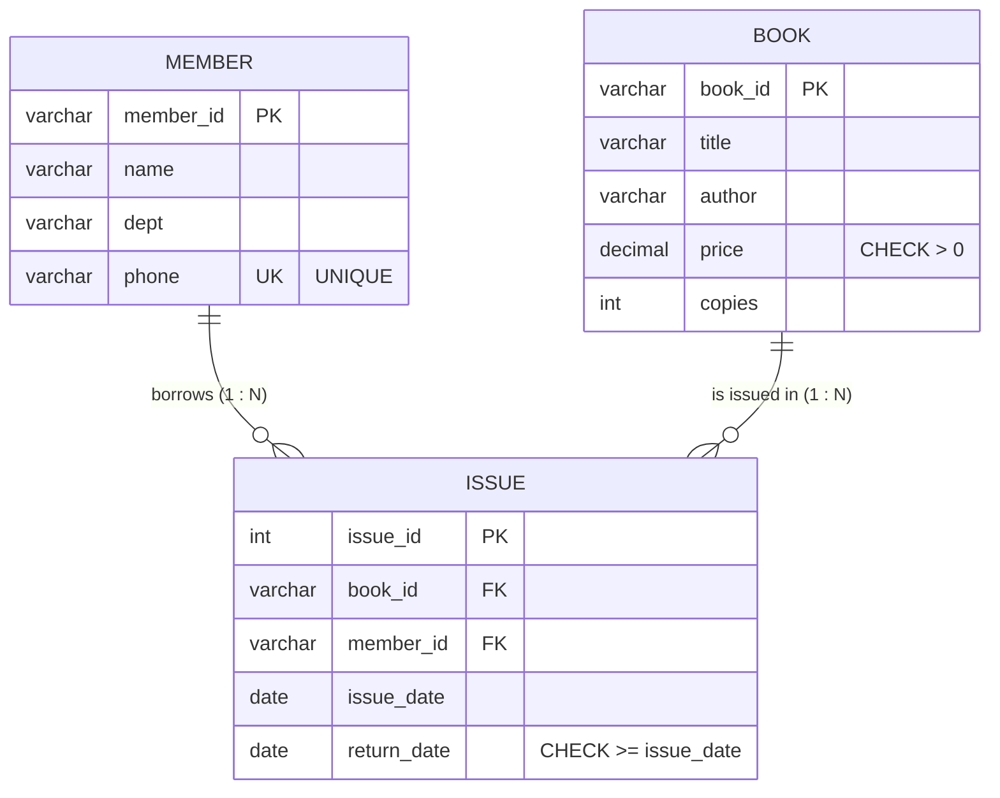

# Explanation - 1A Library

## ER / structure diagram

## Concepts used

* **PRIMARY KEY** = NOT NULL + UNIQUE, one per table. **FOREIGN KEY** keeps Issue rows pointing at real Book/Member rows (referential integrity).
* **UNIQUE** (phone) rejects duplicates but still allows several NULLs; **CHECK** is enforced from MySQL 8.0.16 (older MySQL silently ignored it).
* **DDL** (CREATE/ALTER/DROP/TRUNCATE) auto-commits and cannot be rolled back; **DML** (INSERT/UPDATE/DELETE) can.
* **DCL**: GRANT / REVOKE manage privileges; `SHOW GRANTS` verifies them.
* Oracle differences: `MODIFY` instead of `MODIFY COLUMN`, `SYSDATE` instead of `CURRENT_DATE` in defaults, `DESCRIBE` works in both, users are created with `CREATE USER x IDENTIFIED BY pwd` (no `'@host'`).

## Task-by-task logic

### Core tasks (from the PDF)

**Task 1 - ER diagram with cardinalities (see 01_schema.sql and 06_explanation.md)**  
A member can borrow many books and a book can be borrowed many times, so Book-Member is M:N. The M:N is resolved by the Issue table: Member 1---N Issue and Book 1---N Issue.

**Task 2 - Create the three tables with PK, FK, NOT NULL, UNIQUE, CHECK**  
Tables were created in 01_schema.sql; SHOW CREATE TABLE proves every constraint is stored.

**Task 3 - Insert given rows, then insert an issue for a non-existent book (FK error)**  
Rows were loaded by 02_sample_data.sql. B999 has no parent row in Book, so InnoDB rejects the insert with error 1452.

**Task 4 - Negative price and duplicate phone**  
price = -50 violates chk_book_price (error 3819); phone 9822011111 already belongs to M01 so uq_member_phone fires (error 1062).

**Task 5 - ALTER - add email column, widen title**  
ADD COLUMN adds a nullable column, existing rows get NULL. MODIFY COLUMN changes the data type in place (VARCHAR(60) -> VARCHAR(100)).

**Task 6 - DEFAULT CURRENT_DATE on issue_date**  
MySQL 8.0.13+ allows an expression default, so it must be written in parentheses: DEFAULT (CURRENT_DATE). The new row below omits issue_date and receives today's date; it is then removed again to keep the data intact.

**Task 7 - Increase price of all Kanetkar books by 10%**  
Only the row WHERE author = 'Kanetkar' (B103) changes: 350 * 1.10 = 385.

**Task 8 - Mark B103 as returned today**  
return_date IS NULL ensures only the open loan is closed. CHECK(return_date >= issue_date) still passes (2026-10-05 <= today).

**Task 9 - Members currently holding more than 1 unreturned book**  
GROUP BY member, count only rows with return_date IS NULL, HAVING filters groups (WHERE cannot filter on an aggregate). After task 8 nobody holds two books, so the first result is empty. The second run temporarily issues one more book to M01 inside a transaction (then ROLLBACK) to prove the query works.

**Task 10 - Delete member M03 and show remaining rows**  
M03 has no Issue rows, so the delete is allowed. (Deleting M01 would fail: see ADV 3 - RESTRICT behaviour of the FK.)

**Task 11 - User librarian, GRANT SELECT, INSERT on Issue, REVOKE INSERT, SHOW GRANTS**  
DCL: privileges are stored per account. After REVOKE only SELECT on library_1a.Issue remains. (Oracle: GRANT ... TO librarian; no host part.)

**Task 12 - TRUNCATE a copy of Issue, DROP the copy; DELETE vs TRUNCATE vs DROP**  
DELETE = DML, row by row, WHERE allowed, rollback-able, keeps AUTO_INCREMENT. TRUNCATE = DDL, removes all rows quickly, resets AUTO_INCREMENT, cannot be rolled back, no WHERE. DROP removes rows AND the table structure.

### Advanced / examiner-style queries

**Adv 1 - Books that have never been issued**  
LEFT JOIN keeps every book; rows with no match have NULL on the Issue side.

**Adv 2 - Who currently holds which book (unreturned loans), with days held**  
DATEDIFF(CURRENT_DATE, issue_date) is the number of days since the book left the library.

**Adv 3 - Delete a member who still has issue records (RESTRICT behaviour)**  
The default FK action is RESTRICT/NO ACTION, so M01 (with 2 issue rows) cannot be deleted -> error 1451.

**Adv 4 - Overdue loans (policy: 14 days) for books not returned**  

**Adv 5 - Total inventory value per author**  

**Adv 6 - Add ON DELETE CASCADE to the member FK, delete M02 and see its loans disappear**  
Re-creating the FK with CASCADE makes the child rows follow the parent. Done inside a transaction-free demo, so we restore data afterwards.
