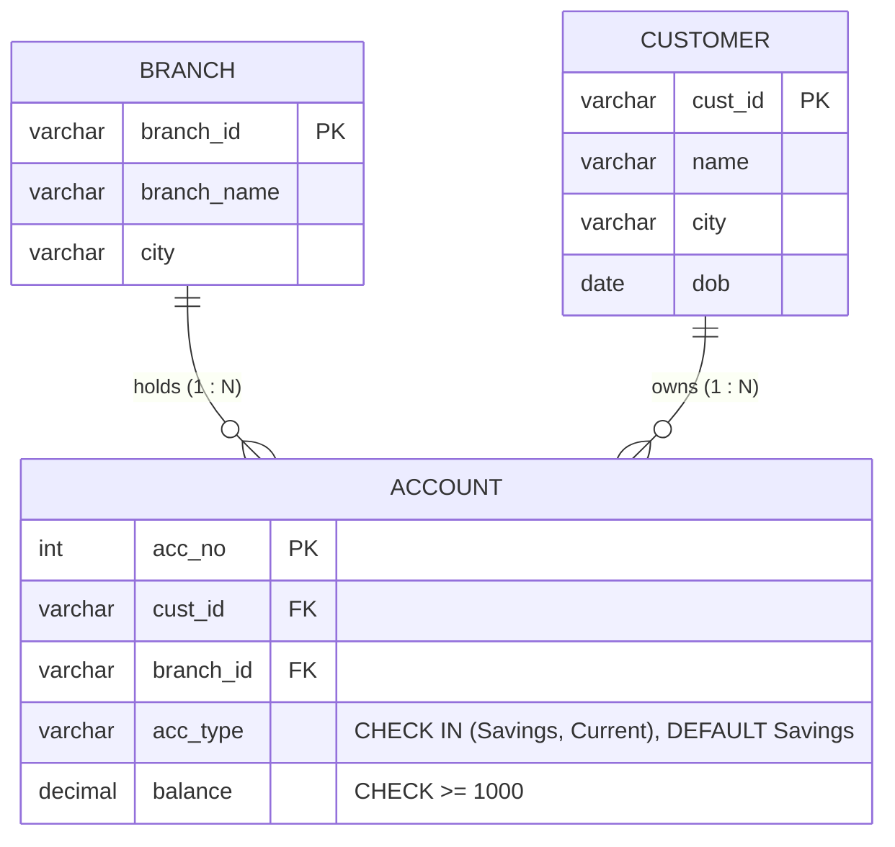

# Explanation - 1B Bank

## ER / structure diagram

## Concepts used

* **CHECK** with `IN (...)` models an enumeration; **DEFAULT** supplies a value when the column is omitted.
* **Column-level privilege**: `GRANT UPDATE (balance)` lets a user change only that column.
* `RENAME TABLE` keeps data, indexes and FKs (FKs automatically follow the new name).
* A copy made with `CREATE TABLE ... AS SELECT` has the data but **no constraints**, which is why it is safe to experiment on.
* Oracle: `RENAME Branch TO Bank_Branch;`, `ALTER TABLE ... ADD open_date DATE DEFAULT SYSDATE`.

## Task-by-task logic

### Core tasks (from the PDF)

**Task 1 - ER diagram for Branch, Customer, Account**  
Branch 1:N Account and Customer 1:N Account; Account is the many side and holds both FKs. See the diagram in 06_explanation.md.

**Task 2 - Tables with CHECK(balance >= 1000), CHECK(acc_type IN (...)) and DEFAULT 'Savings'**  
Proof of DEFAULT: insert an account without acc_type, it becomes 'Savings'; the row is then removed.

**Task 3 - Insert rows; balance 500 and type 'Fixed' must both fail**  
500 < 1000 violates chk_acc_balance; 'Fixed' is not in the allowed list so chk_acc_type is violated. Both give error 3819.

**Task 4 - Account for a non-existent branch (FK error)**  
BR9 is absent from Branch, so error 1452 (foreign key constraint fails).

**Task 5 - Customers holding more than one account**  
GROUP BY customer + HAVING COUNT(*) > 1; only Rahul (C1) has two accounts (5001, 5004).

**Task 6 - Add 4% interest to all Savings accounts**  
Savings accounts 5001 (25000 -> 26000) and 5003 (8000 -> 8320) change; Current accounts are untouched.

**Task 7 - Add column open_date with DEFAULT CURRENT_DATE**  
Existing rows also receive the default value (today) when a NOT NULL-with-default column is added.

**Task 8 - Total balance held at each branch**  
Aggregate per branch; LEFT JOIN from Branch so that a branch without accounts would still show with total 0.

**Task 9 - Delete accounts with balance below 10,000 - in a COPY of the table**  
The copy (CREATE TABLE AS SELECT) has no constraints; only account 5003 (8320) is below 10000, so it is removed from the copy only.

**Task 10 - Rename Branch to Bank_Branch; TRUNCATE a copy of Account and show it is empty**  
RENAME TABLE is DDL; the FK from Account automatically follows the renamed parent.

**Task 11 - User cashier with SELECT and UPDATE(balance); UPDATE of acc_type must fail**  
Column privilege: cashier may change only balance. Changing acc_type gives ERROR 1143 (UPDATE command denied for column).

**Task 12 - REVOKE UPDATE from cashier and verify with SHOW GRANTS**  
After the column-level REVOKE only SELECT remains; a later UPDATE by cashier is denied.

### Advanced / examiner-style queries

**Adv 1 - Customers with their total balance and number of accounts, richest first**  

**Adv 2 - Branch with the highest total balance**  
ORDER BY ... LIMIT 1 on the grouped result.

**Adv 3 - Customers older than 35 as of today with their accounts**  

**Adv 4 - Delete the customer who still has accounts (RESTRICT)**  
Error 1451 because Account rows reference C1.

**Adv 5 - Violate NOT NULL: insert a customer with no name**  
Error 1048 (Column 'name' cannot be null).

**Adv 6 - Duplicate primary key**  
Error 1062 because account 5001 already exists.
