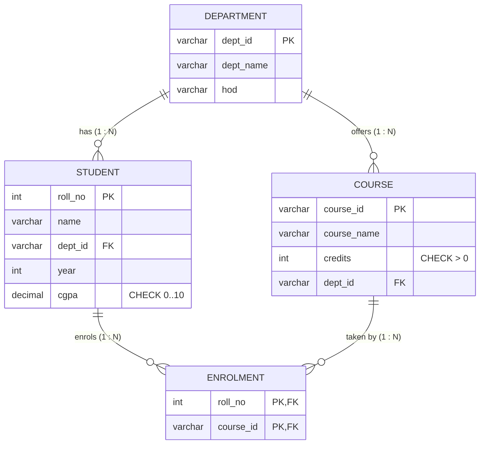

# Explanation - 1C College

## ER / structure diagram

## Concepts used

* **Composite primary key** `(roll_no, course_id)` makes the pair unique and implements the M:N relationship.
* **ON DELETE CASCADE** deletes child rows automatically when the parent row is deleted; the default (RESTRICT) blocks the delete.
* MySQL cannot "modify" an FK: drop it (`DROP FOREIGN KEY name`) and add it again with the new action.
* `RENAME COLUMN` is MySQL 8.0 syntax (Oracle: `ALTER TABLE t RENAME COLUMN a TO b`).
* A user with only SELECT may read; any write gives error 1142.

## Task-by-task logic

### Core tasks (from the PDF)

**Task 1 - ER diagram (entities, attributes, cardinality, M:N Enrolment)**  
See 06_explanation.md. Student M:N Course is resolved by Enrolment(roll_no, course_id).

**Task 2 - Tables with all constraints**  
CHECK (cgpa BETWEEN 0 AND 10) and CHECK (credits > 0) are stored with the table definition.

**Task 3 - Insert data; student with cgpa 11 must fail**  
11 is outside 0..10 so chk_student_cgpa is violated (error 3819).

**Task 4 - Add UNIQUE column email to Student, then drop it**  
Adding a UNIQUE column creates an index named after the column; DROP COLUMN removes the column and its index.

**Task 5 - Increase year of all D1 students by 1**  
101 and 102 move from year 2 to year 3.

**Task 6 - Students enrolled in DBMS**  
Three-table join Student -> Enrolment -> Course filtered on the course name: Aditya and Neha.

**Task 7 - Number of students in each department**  
LEFT JOIN keeps departments with zero students (none here, since every department has one) and COUNT(student column) ignores NULLs.

**Task 8 - Students with cgpa above 8 in AIML**  
Aditya (8.4) and Neha (9.1) satisfy dept = AIML and cgpa > 8.

**Task 9 - Delete course C201 - error first, then recreate FK with ON DELETE CASCADE and delete again**  
C201 is referenced by Enrolment (103, C201) -> error 1451. After the FK is recreated with CASCADE the enrolment row is removed with the course.

**Task 10 - Rename column hod to head_of_dept**  

**Task 11 - User faculty1 with SELECT on Student; log in as faculty1 and try an UPDATE**  
SELECT works; UPDATE gives ERROR 1142 (UPDATE command denied).

**Task 12 - REVOKE SELECT from faculty1 and DROP the user**  

### Advanced / examiner-style queries

**Adv 1 - Courses with number of enrolled students (including courses with none)**  

**Adv 2 - Students enrolled in no course**  
NOT EXISTS anti-join: priya (104) has no enrolment.

**Adv 3 - Total credits per student**  

**Adv 4 - Duplicate enrolment (composite PK violation)**  
(101, C101) already exists -> error 1062.

**Adv 5 - Student of an unknown department**  
Error 1452 because D9 does not exist.

**Adv 6 - Highest cgpa student in each department**  

