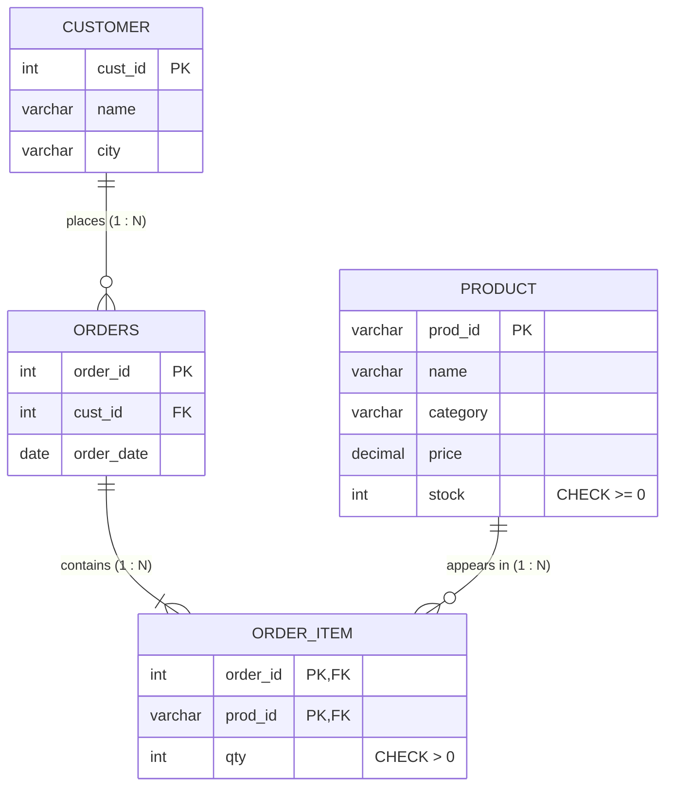

# Explanation - 1D Online Shop

## ER / structure diagram

## Concepts used

* **Order_Item** is the junction table of Orders and Product (M:N) with composite PK `(order_id, prod_id)`, so a product appears once per order.
* **UPDATE with JOIN** (MySQL): `UPDATE a JOIN (SELECT ...) b ON ... SET a.col = ...` applies one value per matching product.
* Deleting through two levels (Customer -> Orders -> Order_Item) needs CASCADE on **both** FKs.
* **Roles** (MySQL 8): `CREATE ROLE`, `GRANT priv TO role`, `GRANT role TO user`, `SET DEFAULT ROLE`. Revoking from the role changes all members at once.
* Oracle: `CREATE ROLE sales_staff; GRANT SELECT ON Product TO sales_staff; GRANT sales_staff TO shop_user;`

## Task-by-task logic

### Core tasks (from the PDF)

**Task 1 - ER diagram for Customer, Product, Orders, Order_Item**  
Customer 1:N Orders, Orders 1:N Order_Item, Product 1:N Order_Item (Orders M:N Product). See 06_explanation.md.

**Task 2 - Tables with composite PK and CHECKs**  

**Task 3 - Insert data; Order_Item with qty 0 must fail**  
qty = 0 violates chk_item_qty (error 3819).

**Task 4 - Product with a duplicate prod_id**  
'P1' already exists -> error 1062 Duplicate entry for key 'product.PRIMARY'.

**Task 5 - All orders of Sagar with product names**  
Customer -> Orders -> Order_Item -> Product join, filtered by customer name; qty*price gives the line amount.

**Task 6 - Reduce stock of each product by the quantity ordered**  
The derived table sums quantities per product; the UPDATE joins to it. P1 10->9, P2 100->98, P3 500->490, P4 25->24.

**Task 7 - Products whose stock is below 20**  
Only the Laptop (9) is below 20 after Task 6.

**Task 8 - Add discount column with DEFAULT 0 and CHECK (discount BETWEEN 0 AND 50)**  
Existing rows get 0. Value 60 is rejected by the new CHECK.

**Task 9 - Increase Stationery prices by 5%**  
Only Notebook (60) changes: 60 * 1.05 = 63.

**Task 10 - Delete customer 1 with a plain FK (error), then with ON DELETE CASCADE**  
Plain FK: error 1451 because Orders 1001 and 1003 belong to Sagar. The cascade must be defined on Orders->Customer AND Order_Item->Orders because Order_Item rows hang below Orders. After the delete, Sagar, orders 1001/1003 and their 3 items are gone.

**Task 11 - Role sales_staff (SELECT on Product, INSERT on Orders) granted to a new user**  
The user inherits privileges through the role. SET DEFAULT ROLE activates it at login.

**Task 12 - Revoke INSERT from the role; the user can no longer insert orders**  
Revoking from the role immediately affects every user holding it. New INSERT -> ERROR 1142.

### Advanced / examiner-style queries

**Adv 1 - Order value per order**  

**Adv 2 - Customers who never ordered**  

**Adv 3 - Category-wise product count and average price**  

**Adv 4 - Order item for a product that does not exist**  
Error 1452 (fk_item_product).

**Adv 5 - Negative stock via UPDATE**  
Error 3819: CHECK (stock >= 0) also protects UPDATE, not only INSERT.

**Adv 6 - Same product twice in one order (composite PK)**  
Error 1062: (1002, 'P3') already exists; the application should UPDATE qty instead.
