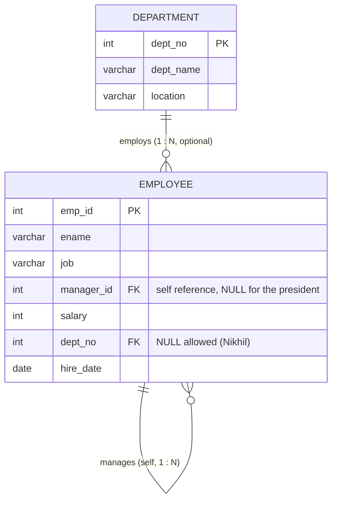

# Explanation - 2A Employee Department

## ER / structure diagram

## Concepts used

* **INNER JOIN** keeps only matching rows (Nikhil, who has no department, disappears). **LEFT JOIN** keeps all rows of the left table; **RIGHT JOIN** is the mirror image.
* **Self join**: the same table used twice with different aliases (employee `e`, manager `m`).
* **Correlated subquery**: the inner query refers to the outer row and is evaluated once per outer row.
* `> ALL (subquery)` = greater than the maximum; `> ANY (subquery)` = greater than the minimum.
* **WHERE** filters rows, **HAVING** filters groups. Window functions (`DENSE_RANK`) are MySQL 8 / Oracle.
* A view is a stored SELECT; a *simple* view (one table, no aggregates/DISTINCT/GROUP BY) is updatable, a *complex* one is not.

## Task-by-task logic

### Core tasks (from the PDF)

**Task 1 - Employee name with department name (INNER JOIN)**  
Only employees whose dept_no matches a department are returned: 7 rows (Nikhil has NULL dept_no and is excluded).

**Task 2 - All departments with their employees, including empty departments (LEFT JOIN)**  
Department is the left table so Operations (40) appears once with NULL employee columns.

**Task 3 - All employees including those without a department (LEFT and RIGHT join forms)**  
Both statements return the same 8 rows; Nikhil shows NULL dept_name. RIGHT JOIN is simply LEFT JOIN with the tables swapped.

**Task 4 - Employee with the name of their manager (self join)**  
LEFT JOIN so the president (manager_id NULL) is still listed with NULL manager.

**Task 5 - Employees earning more than the average of their own department (correlated subquery)**  
For each outer row the inner AVG is recomputed for that row's dept_no. Averages: dept 10=150000, 20=71666.67, 30=52666.67.

**Task 6 - Employees earning more than every Salesman (ALL)**  
Salesmen earn 35000 and 38000, so `> ALL` means > 38000: every non-salesman except Nikhil (25000).

**Task 7 - Department-wise count, total and average salary, only departments with more than 2 employees**  
GROUP BY dept_no then HAVING COUNT(*) > 2: Research (3) and Sales (3). Accounts (1) is filtered out. The NULL-department group is dropped by the INNER JOIN.

**Task 8 - Employee(s) with the second highest salary**  
(a) Two nested MAX: highest salary below the maximum. (b) DENSE_RANK() handles ties and is easily generalised to "Nth highest".

**Task 9 - Department with the highest total salary**  
Group by department, order by the sum descending, take one row. Research = 215000 (Anita 90000 + Rohit 60000 + Kavya 65000).

**Task 10 - Employees hired after 2019 in Research, ordered by salary descending**  
"After 2019" is read as YEAR(hire_date) > 2019, so Rohit (2019-07-01) is excluded; only Kavya (2020-02-20) qualifies.

**Task 11 - Views emp_no_dept and dept_summary**  
emp_no_dept is a simple filtered view; dept_summary is a complex (aggregating) view.

**Task 12 - Update a salary through a simple view, show base table, DROP the views**  
A simple view maps 1:1 to base rows, so UPDATE passes through (Nikhil 25000 -> 27000). The aggregate view is NOT updatable (error 1288).

### Advanced / examiner-style queries

**Adv 1 - Third highest salary using LIMIT/OFFSET on distinct salaries**  

**Adv 2 - Managers with the number of direct reports**  

**Adv 3 - Employees earning more than their own manager**  

**Adv 4 - Departments with no employees using NOT EXISTS**  

**Adv 5 - Salary rank within each department**  

**Adv 6 - Employees earning more than ANY Analyst**  
ANY = greater than the minimum Analyst salary (60000).

**Adv 7 - FULL OUTER JOIN emulation (MySQL has none) - all employees and all departments**  

**Adv 8 - Updatable view with CHECK OPTION blocks rows leaving the view**  
Moving an Analyst to salary 10 would still pass, but changing job to 'Clerk' violates the view predicate -> error 1369.
