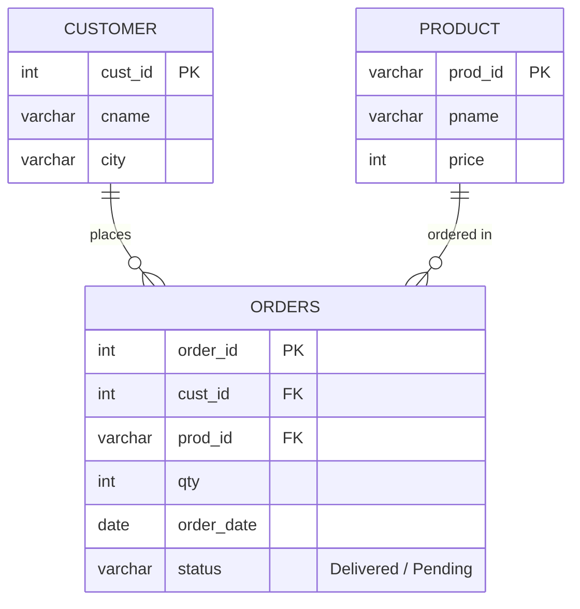

# Explanation - 2B Sales

## ER / structure diagram

## Concepts used

* Amount = `qty * price`, computed in the SELECT list after joining Orders to Product.
* Top-N = `ORDER BY ... DESC LIMIT N`. NOT EXISTS / NOT IN are two ways of writing an anti-join; **NOT IN breaks with NULLs** in the subquery.
* `DATE_FORMAT(order_date,'%Y-%m')` groups by month; HAVING filters on the group total.
* "Customers who ordered **every** product of X" is relational division, written with a double NOT EXISTS.
* Views can wrap a join and a filter; views can be queried like tables, including with further WHERE conditions.

## Task-by-task logic

### Core tasks (from the PDF)

**Task 1 - order_id, customer name, product name and amount (qty x price)**  
Joins Orders with Customer and Product; amount is calculated per order row.

**Task 2 - Total amount spent by each customer**  
Ganesh Traders 30000+13500+25200=68700; Shree Mart 31500+37500=69000; Om Stores 15000; City Bazaar has no orders so LEFT JOIN shows 0.

**Task 3 - Top 3 customers by total purchase amount**  
Same aggregation, ordered descending and cut with LIMIT 3.

**Task 4 - Products never ordered (NOT EXISTS) and customers who never ordered (NOT IN)**  
Tea (P4) is never ordered; City Bazaar has no orders. NOT IN is safe here because Orders.cust_id is NOT NULL (a NULL in the list would make NOT IN return nothing).

**Task 5 - Month-wise revenue, only months above 50,000**  
Aug = 30000+31500 = 61500, Sep = 13500+15000 = 28500 (filtered out), Oct = 37500+25200 = 62700.

**Task 6 - Most ordered product by total quantity**  
Rice 25 kg: 20 + 10 + 25 = 55 units, far above oil (27) and sugar (30).

**Task 7 - City-wise number of orders and revenue**  

**Task 8 - Orders whose amount is above the average order amount**  
Average amount = 152700 / 6 = 25450. Orders 1 (30000), 2 (31500) and 5 (37500) exceed it; order 6 (25200) is just below.

**Task 9 - Customers who ordered every product that Ganesh Traders ordered**  
Relational division with double NOT EXISTS: there must be no product ordered by Ganesh that this customer did not order. Ganesh ordered P1, P2, P3, so only Ganesh himself qualifies; the second query excludes him and returns an empty set.

**Task 10 - Count orders by status**  

**Task 11 - View pending_orders; query it for Pune customers**  
The view hides the join; filtering on city requires city in the view, so it is included. Shree Mart's pending order 5 = 25 x 1500.

**Task 12 - View customer_revenue; customers whose revenue exceeds 30,000**  
Ganesh Traders (68700) and Shree Mart (69000) qualify; Om Stores (15000) does not.

### Advanced / examiner-style queries

**Adv 1 - Running total of revenue by order date (window function)**  

**Adv 2 - Rank customers by revenue (RANK)**  

**Adv 3 - Each customer's share of total revenue (%)**  

**Adv 4 - NOT IN trap - a NULL in the subquery makes NOT IN return no rows**  
The subquery contains a NULL, so `x NOT IN (..., NULL)` is UNKNOWN for every x and the result is empty. NOT EXISTS is NULL-safe.

**Adv 5 - Orders with an invalid status**  
CHECK (status IN ('Delivered','Pending')) rejects it with error 3819.

**Adv 6 - Products ordered by more than one distinct customer**  

