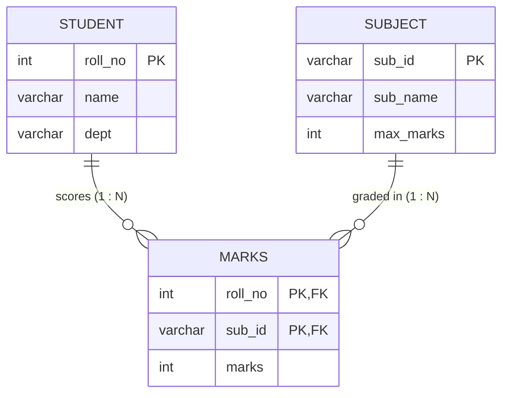

# Explanation - 2C University Results

## ER / structure diagram

## Concepts used

* `> ALL (subquery)` compares with the maximum, `> ANY (subquery)` with the minimum of the subquery result.
* Topper-per-group: join to a MAX() derived table, or use `RANK() OVER (PARTITION BY ...)`.
* `SUM(marks < 40)` counts rows because a true comparison evaluates to 1 in MySQL (Oracle: `SUM(CASE WHEN ... THEN 1 ELSE 0 END)`).
* A multi-table view is updatable if one UPDATE touches columns of **one** base table only; `WITH CHECK OPTION` stops rows from leaving the view.

## Task-by-task logic

### Core tasks (from the PDF)

**Task 1 - Student name, subject name and marks**  

**Task 2 - Each student's total and average marks**  
Esha has only one subject, so total = average = 67. Average is over subjects actually taken.

**Task 3 - Students who scored more than ALL AIML students in DBMS**  
AIML DBMS marks are 78 and 35; "> ALL" means > 78, so only Chetan (91) qualifies.

**Task 4 - Students who scored more than ANY CSE student in DBMS**  
CSE DBMS marks are 91 and 55; "> ANY" means > 55 (the minimum): Asha 78, Esha 67 and Chetan 91 (more than Divya's 55).

**Task 5 - Subject-wise average, highest and lowest marks**  

**Task 6 - Topper's name for each subject**  
Derived table gives MAX(marks) per subject; joining back returns the student(s) holding it (ties would both show).

**Task 7 - Department-wise average marks having average > 60**  
AIML (78+85+35+62)/4 = 65, CSE (91+74+55+38)/4 = 64.5, ENTC 67. All three exceed 60.

**Task 8 - Number of students who failed (marks < 40) in each subject**  
LEFT JOIN-free version: SUM of a boolean. DBMS: Bhushan(35); ML: none; DAA: Divya(38).

**Task 9 - Students who appeared for DBMS but not for ML (NOT IN)**  

**Task 10 - Students who appeared in more than one subject**  

**Task 11 - Rank students by DBMS marks (ORDER BY and RANK())**  
RANK() leaves gaps after ties; no ties here so ranks are 1..5.

**Task 12 - View below_40 and UPDATE marks through it**  
The join view is updatable for marks (single base table Marks). Raising Bhushan's DBMS marks to 45 succeeds, and the row then vanishes from the view because it no longer satisfies marks < 40 (no CHECK OPTION). Changing columns of two tables at once fails (error 1393). With WITH CHECK OPTION the same UPDATE is rejected (error 1369). Everything runs inside a transaction that is rolled back.

### Advanced / examiner-style queries

**Adv 1 - Second highest DBMS mark**  

**Adv 2 - Result class per student (>=75 Distinction, >=40 on every subject Pass)**  
MIN(marks) < 40 means at least one failed subject.

**Adv 3 - Students appearing in every subject (division via counts)**  

**Adv 4 - Subject-wise rank of every student (PARTITION BY)**  

**Adv 5 - Marks above the subject maximum (CHECK would be needed) - show how to guard**  
The schema only checks marks >= 0, so 150 is accepted; this demonstrates a missing-constraint discussion point, rolled back.

**Adv 6 - Negative marks**  
chk_marks rejects it with error 3819.
