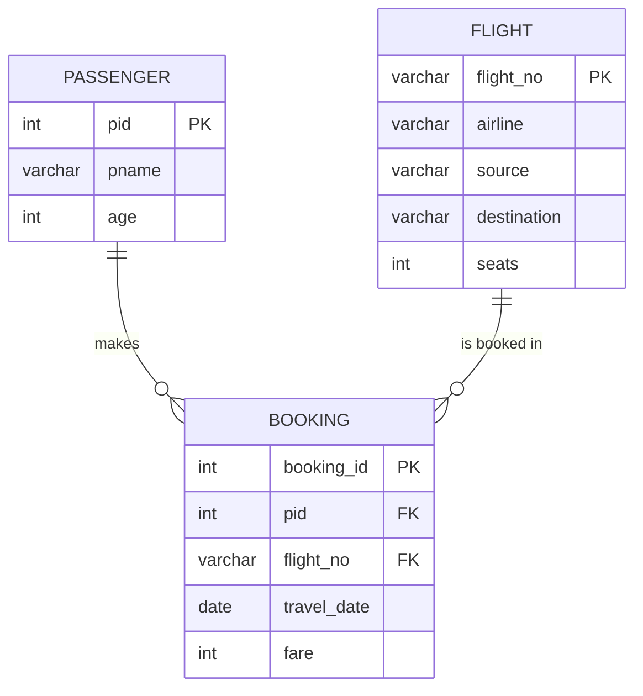

# Explanation - 2D Flight Booking

## ER / structure diagram

## Concepts used

* LEFT JOIN ... `WHERE right.key IS NULL` is the classic anti-join (rows with no match).
* Occupancy = bookings / seats x 100 (one booking = one seat in this data set).
* Correlated subquery with AVG on the same flight finds fares above the flight's own average.
* Passengers who did X **but never** Y: `EXISTS (X)` combined with `NOT EXISTS (Y)`.

## Task-by-task logic

### Core tasks (from the PDF)

**Task 1 - Passenger name, flight number, airline and travel date**  

**Task 2 - Passengers who booked more than 2 flights**  
Only Rajesh has 3 bookings.

**Task 3 - Flights with no bookings (LEFT JOIN ... IS NULL)**  
6E404 (Mumbai -> Delhi) has no matching Booking row.

**Task 4 - Airline-wise number of bookings and total revenue**  
Air India 2 / 13000, IndiGo 2 / 6600, Vistara 1 / 4800.

**Task 5 - Occupancy percentage of each flight (bookings / seats x 100)**  
LEFT JOIN keeps 6E404 with 0%. Values are small because only five bookings exist in the sample.

**Task 6 - Passengers who paid a fare above the average fare of their flight**  
Correlated subquery: the average is taken over the bookings of the SAME flight. AI101 fares are 6500 and 6500 (average 6500), so the strict > returns no row for it; UK303 has a single fare; 6E202 has 3200 (Rajesh) and 3400 (Arjun), average 3300, so only Arjun's 3400 is above it.

**Task 7 - Flight with the highest revenue**  
AI101 earns 6500 + 6500 = 13000.

**Task 8 - Passengers who travelled with IndiGo but never with Air India**  
Rajesh flew IndiGo and Air India, so he is excluded; Arjun flew only IndiGo.

**Task 9 - Route-wise (source -> destination) average fare**  

**Task 10 - Passengers aged below 30 and their bookings**  
LEFT JOIN so that Mitali (22, no booking) still appears with NULL booking columns.

**Task 11 - View pune_departures; list passengers flying from Pune**  
Flights leaving Pune: AI101 and UK303; Rajesh (both) and Sonal (AI101).

**Task 12 - Airlines whose total revenue is greater than 5,000**  
GROUP BY airline HAVING SUM(fare) > 5000: Air India 13000 and IndiGo 6600; Vistara (4800) is excluded.

### Advanced / examiner-style queries

**Adv 1 - Busiest route by number of bookings**  

**Adv 2 - Passengers who never booked**  

**Adv 3 - Passengers who flew on every airline they could (flights from Pune)**  
Division: passengers having a booking on every flight departing from Pune. Only Rajesh booked both AI101 and UK303.

**Adv 4 - Fare difference of each booking from the passenger's own average**  

**Adv 5 - Booking for a flight that does not exist**  
Error 1452.

**Adv 6 - Booking with zero fare**  
Error 3819 (chk_b_fare).
