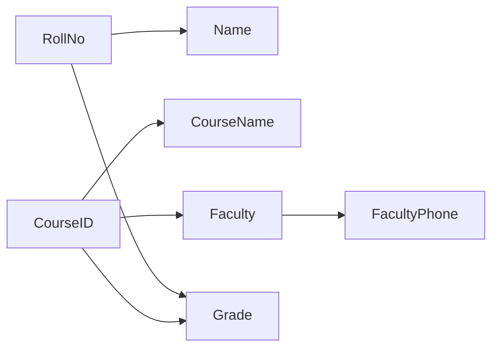
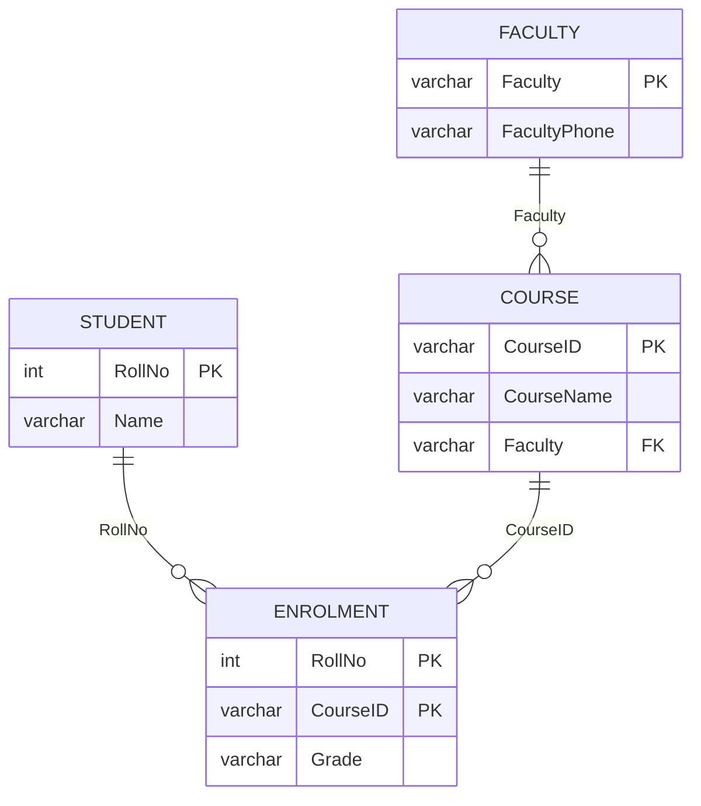

# 3A Student_Course - step-by-step normalisation derivation

**Relation** `Student_Course(RollNo, Name, CourseID, CourseName, Faculty, FacultyPhone, Grade)`

**Functional dependencies (from the PDF)**

| # | FD |
|---|----|
| F1 | RollNo -> Name |
| F2 | CourseID -> CourseName, Faculty |
| F3 | Faculty -> FacultyPhone |
| F4 | {RollNo, CourseID} -> Grade |

## Step 0 - Unnormalised form
Cells like `CourseID = "C1, C2"`, `Grade = "A, B"` hold lists. The i-th element of each list belongs together.

## Step 1 - 1NF
Make each cell atomic: one row per (student, course). Result (5 rows):

| RollNo | Name | CourseID | CourseName | Faculty | FacultyPhone | Grade |
|---|---|---|---|---|---|---|
| 101 | Aditya | C1 | DBMS | Dr. Patil | 9800011111 | A |
| 101 | Aditya | C2 | ML | Dr. Kale | 9800022222 | B |
| 102 | Neha | C1 | DBMS | Dr. Patil | 9800011111 | A+ |
| 103 | Omkar | C2 | ML | Dr. Kale | 9800022222 | B |
| 103 | Omkar | C3 | DAA | Dr. Joshi | 9800033333 | A |

## Step 2 - Attribute closures and candidate key
* {RollNo}+ : start {RollNo}; F1 adds Name -> **{RollNo, Name}** (not everything).
* {CourseID}+ : F2 adds CourseName, Faculty; F3 adds FacultyPhone -> {CourseID, CourseName, Faculty, FacultyPhone} (no RollNo, no Grade).
* {RollNo, CourseID}+ : F1 Name; F2 CourseName, Faculty; F3 FacultyPhone; F4 Grade -> **all 7 attributes**.
* No proper subset of {RollNo, CourseID} determines everything, so **candidate key = {RollNo, CourseID}** (the only one). Prime attributes: RollNo, CourseID. Non-prime: Name, CourseName, Faculty, FacultyPhone, Grade.

## Step 3 - Anomalies in the 1NF table
| Type | Example |
|---|---|
| Insert | Cannot add course C4 / Dr. Mane before a student enrols (RollNo is part of the key and cannot be NULL). |
| Update | Dr. Kale's phone is stored in 2 rows; updating one row leaves inconsistent phones. Name of Aditya is stored twice. |
| Delete | Deleting Omkar's only C3 row deletes the facts "C3 = DAA, Dr. Joshi, 9800033333". |

## Step 4 - 2NF (remove partial dependencies)
Partial dependencies: F1 (RollNo is only part of the key), F2 (CourseID is only part of the key) and, through F2+F3, CourseID -> FacultyPhone.

| Relation | Key | FDs |
|---|---|---|
| Student(RollNo, Name) | RollNo | F1 |
| Course_Faculty(CourseID, CourseName, Faculty, FacultyPhone) | CourseID | F2, F3 |
| Enrolment(RollNo, CourseID, Grade) | {RollNo, CourseID} | F4 |

Lossless: common attribute of Student and Enrolment = RollNo (key of Student); of Course_Faculty and Enrolment = CourseID (key of Course_Faculty). Dependency preserving: F1-F4 each live inside one relation.

## Step 5 - 3NF (remove transitive dependencies)
In Course_Faculty: CourseID -> Faculty -> FacultyPhone is transitive (Faculty is not a key, FacultyPhone is non-prime). Split:

* Course(CourseID, CourseName, Faculty) key CourseID, FK Faculty
* Faculty(Faculty, FacultyPhone) key Faculty

## Step 6 - BCNF check
| Relation | Non-trivial FDs | Determinant a candidate key? |
|---|---|---|
| Student | RollNo -> Name | yes |
| Faculty | Faculty -> FacultyPhone | yes |
| Course | CourseID -> CourseName, Faculty | yes |
| Enrolment | {RollNo, CourseID} -> Grade | yes |

All determinants are candidate keys, so the schema is in **BCNF** (and hence 3NF, 2NF, 1NF).

## Step 7 - Lossless join and dependency preservation
Joining Enrolment-Student (RollNo), Enrolment-Course (CourseID), Course-Faculty (Faculty) reproduces the 5 rows; verified by two anti-joins (0 missing, 0 spurious) in Task 11 and by the chase test in `fd_analysis.py` (`Lossless join : True`). F1-F4 are each contained in a single table, so the decomposition is **dependency preserving**.

## Final ER (normalised)

