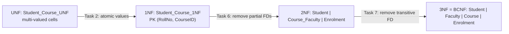

# Explanation - 3A Student Course

## ER / structure diagram

## Concepts used

* **1NF**: every cell atomic, a key exists. **2NF**: 1NF + no partial dependency (non-key attribute depending on part of a composite key).
* **3NF**: 2NF + no transitive dependency (non-key -> non-key). **BCNF**: every determinant is a candidate key.
* **FD check in SQL**: `X -> Y` holds on the data iff `SELECT X FROM t GROUP BY X HAVING COUNT(DISTINCT Y) > 1` returns no rows.
* **Lossless join**: re-joining the decomposed tables gives back exactly the original rows (no spurious, no missing rows).
* Attribute closure and candidate keys are computed by `fd_analysis.py` (see the last section of 05_expected_output.md).

## Task-by-task logic

### Core tasks (from the PDF)

**Task 1 - Why is the given table not in 1NF?**  
Cells such as CourseID = 'C1, C2' hold several values (a repeating group), so the attributes are not atomic and RollNo alone cannot be used to look up one course. The query finds every cell that contains a list.

**Task 2 - Convert to 1NF (one value per cell) - resulting rows**  
Each list element becomes its own row; the key becomes the composite (RollNo, CourseID). 5 rows replace 3.

**Task 3 - One insert, one update and one delete anomaly in the 1NF table**  
INSERT anomaly: a new course C4 with a faculty cannot be stored until a student takes it (RollNo is part of the PK) -> error 1048. UPDATE anomaly: Dr. Kale's phone is stored twice; changing only one row leaves two different phones (inconsistency). DELETE anomaly: Omkar is the only student of C3; deleting his row also erases the fact that C3 = DAA taught by Dr. Joshi.

**Task 4 - Closure of {RollNo} and {RollNo, CourseID}**  
Using FDs RollNo->Name, CourseID->CourseName,Faculty, Faculty->FacultyPhone, {RollNo,CourseID}->Grade: {RollNo}+ = {RollNo, Name};  {RollNo, CourseID}+ = all seven attributes (see fd_analysis.py output). Proof on the data: each FD below holds iff its query returns an empty set.

**Task 5 - Candidate key using attribute closure**  
{RollNo}+ and {CourseID}+ are not the full set, {RollNo,CourseID}+ is, and no proper subset works => candidate key = {RollNo, CourseID}. Data check: the pair is unique, a single column is not.

**Task 6 - Partial dependencies and decomposition to 2NF**  
Partial: RollNo->Name and CourseID->CourseName,Faculty (and FacultyPhone through Faculty); each depends on only part of the key. 2NF tables: Student(RollNo, Name), Course_Faculty(CourseID, CourseName, Faculty, FacultyPhone), Enrolment(RollNo, CourseID, Grade).

**Task 7 - Transitive dependency and decomposition to 3NF**  
CourseID -> Faculty -> FacultyPhone is transitive (Faculty is a non-key attribute determining another non-key attribute). Split Course_Faculty into Course(CourseID, CourseName, Faculty) and Faculty(Faculty, FacultyPhone).

**Task 8 - Check every table for BCNF and justify**  
Student (determinant RollNo = key), Faculty (Faculty = key), Course (CourseID = key), Enrolment ({RollNo,CourseID} = key). Every FD's left side is a candidate key of its own table, so all four tables are in BCNF. Python check: fd_analysis.py ("BCNF violations none").

**Task 9 - Final tables with primary and foreign keys**  

**Task 10 - Insert the data into the normalised tables**  
Parents first (Student, Faculty), then Course, then Enrolment, so every FK has its parent row.

**Task 11 - JOIN that reproduces the 1NF table (lossless join)**  
The four-way join returns exactly the 5 original rows. Both anti-join checks return 0 rows, i.e. nothing is lost and nothing spurious appears.

**Task 12 - Students taught by Dr. Kale with their grades (normalised tables)**  
Dr. Kale teaches C2 (ML): Aditya got B and Omkar got B.

### Advanced / examiner-style queries

**Adv 1 - Faculty-wise student count**  

**Adv 2 - The update anomaly is gone - change Dr. Kale's phone once**  
One UPDATE on Faculty changes the phone for every course and student, and the re-join shows a consistent value.

**Adv 3 - The insert anomaly is gone - a new course with no students**  

**Adv 4 - The delete anomaly is gone - remove Omkar's C3 enrolment and keep the course**  

**Adv 5 - Referential integrity - enrol in a non-existent course**  
Error 1452.

**Adv 6 - Students with their average grade points (A+=10, A=9, B=8)**  

