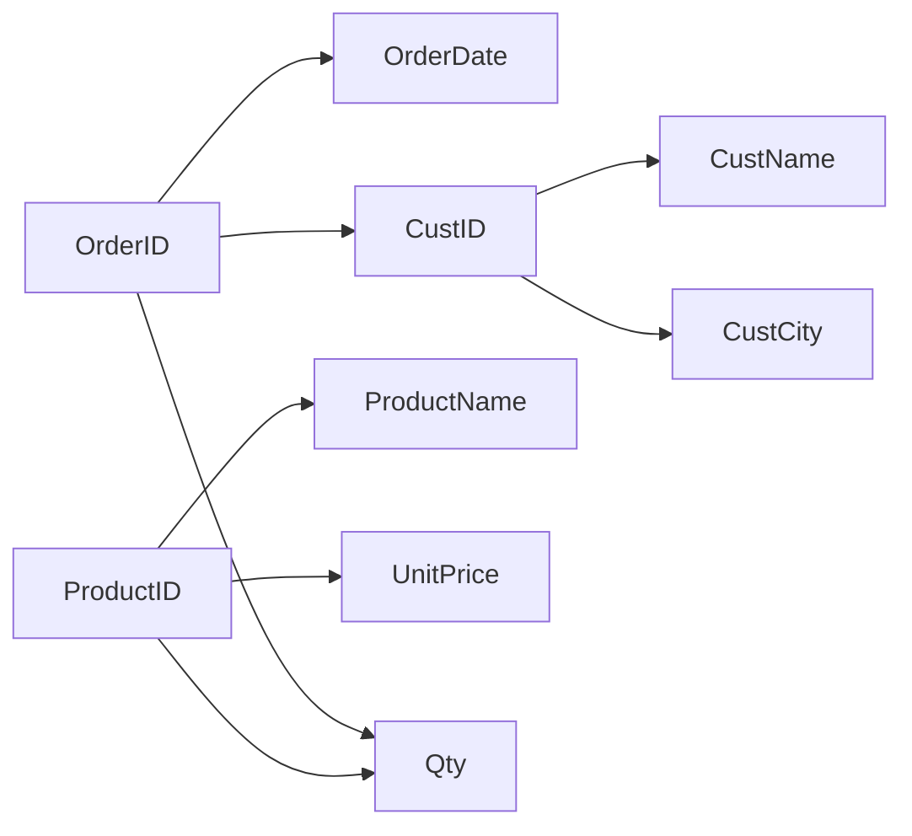
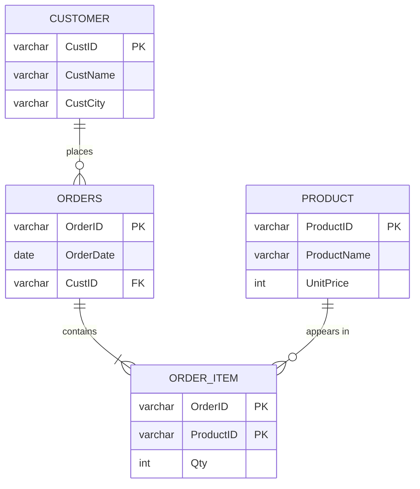

# 3B Order_Details - step-by-step normalisation derivation

`Order_Details(OrderID, OrderDate, CustID, CustName, CustCity, ProductID, ProductName, Qty, UnitPrice)`

| # | FD | Type |
|---|----|------|
| F1 | OrderID -> OrderDate, CustID | partial (OrderID is part of the key) |
| F2 | CustID -> CustName, CustCity | transitive (OrderID -> CustID -> CustName/CustCity) |
| F3 | ProductID -> ProductName, UnitPrice | partial |
| F4 | {OrderID, ProductID} -> Qty | full |

## Candidate key
{OrderID, ProductID}+ : F1 -> OrderDate, CustID; F2 -> CustName, CustCity; F3 -> ProductName, UnitPrice; F4 -> Qty = all 9 attributes. OrderID+ = {OrderID, OrderDate, CustID, CustName, CustCity}; ProductID+ = {ProductID, ProductName, UnitPrice}; neither is complete, so the key is minimal. **Only candidate key: {OrderID, ProductID}.**

## Form of the given relation
All cells atomic with a key => **1NF**. Partial dependencies F1, F3 => **not 2NF**.

## Anomalies
* Insert: cannot record customer C4 or product P9 until an order contains them.
* Update: Sagar/Sangli repeated 3 times, Pen/10 twice; update one copy and the data conflicts.
* Delete: deleting O2 loses Meera/Pune completely.

## 2NF
Move each partially dependent group out with its determinant:

| Relation | Key |
|---|---|
| Order_Header(OrderID, OrderDate, CustID, CustName, CustCity) | OrderID |
| Product(ProductID, ProductName, UnitPrice) | ProductID |
| Order_Item(OrderID, ProductID, Qty) | {OrderID, ProductID} |

## 3NF (and BCNF)
Order_Header still has OrderID -> CustID -> CustName, CustCity (transitive). Split:

| Relation | Key | FK |
|---|---|---|
| Customer(CustID, CustName, CustCity) | CustID | |
| Orders(OrderID, OrderDate, CustID) | OrderID | CustID -> Customer |
| Product(ProductID, ProductName, UnitPrice) | ProductID | |
| Order_Item(OrderID, ProductID, Qty) | {OrderID, ProductID} | OrderID -> Orders, ProductID -> Product |

Every determinant (CustID, OrderID, ProductID, {OrderID, ProductID}) is the key of its table => **BCNF**.

## Lossless + dependency preservation
Binary-join chain: Customer ⋈ Orders on CustID (key of Customer) ⋈ Order_Item on OrderID (key of Orders) ⋈ Product on ProductID (key of Product): each step shares a key, so the join is lossless (chase test `True`, and 0 missing / 0 spurious rows in Task 8). F1 lives in Orders, F2 in Customer, F3 in Product, F4 in Order_Item => **dependency preserving**.

## Final ER

