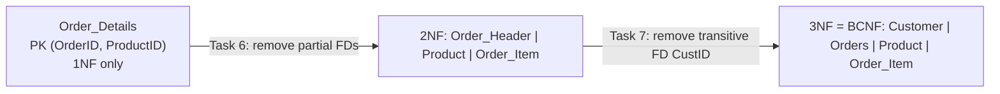

# Explanation - 3B Order Details

## ER / structure diagram

## Concepts used

* Full dependency: whole key -> attribute. Partial: part of the key -> attribute. Transitive: key -> non-key -> non-key.
* Decomposition is **lossless** when the shared attribute is a key of one of the parts; **dependency preserving** when every FD can be checked inside a single table.
* After normalisation each fact (a customer's city, a product's price) is stored once, so one UPDATE is enough.

## Task-by-task logic

### Core tasks (from the PDF)

**Task 1 - Primary key of the given table**  
{OrderID, ProductID}+ contains all attributes and no proper subset does (see fd_analysis.py). Data check: the pair is unique, OrderID alone is not.

**Task 2 - Redundancy (repeated customer and product data)**  
Sagar/Sangli is stored 3 times, Pen/10 twice. Each extra copy is redundant and can become inconsistent.

**Task 3 - One insert, update and delete anomaly**  
INSERT: a new customer C4 or product P9 cannot be stored without an order (OrderID/ProductID are in the PK) -> error 1364/1048. UPDATE: change Sagar's city in one row only -> two different cities for C1. DELETE: deleting order O2 (Meera's only order) also deletes the only record of customer C2 Meera / Pune.

**Task 4 - Classify each FD as full, partial or transitive**  
OrderID -> OrderDate, CustID : PARTIAL (OrderID is part of the key).  CustID -> CustName, CustCity : TRANSITIVE (OrderID -> CustID -> CustName). ProductID -> ProductName, UnitPrice : PARTIAL.  {OrderID, ProductID} -> Qty : FULL.

**Task 5 - Closure of {OrderID, ProductID}**  
Start {OrderID, ProductID}; OrderID adds OrderDate, CustID; CustID adds CustName, CustCity; ProductID adds ProductName, UnitPrice; the FD for Qty adds Qty => all 9 attributes, so it is a superkey (and a candidate key because it is minimal). Computed by fd_analysis.py.

**Task 6 - Decompose to 2NF**  
Remove partial dependencies: Order_Header(OrderID, OrderDate, CustID, CustName, CustCity), Product(ProductID, ProductName, UnitPrice), Order_Item(OrderID, ProductID, Qty).

**Task 7 - Decompose to 3NF and verify BCNF**  
In Order_Header: OrderID -> CustID -> CustName, CustCity is transitive. Split into Orders(OrderID, OrderDate, CustID) and Customer(CustID, CustName, CustCity). Every determinant is now the key of its table => BCNF.

**Task 8 - Lossless join and dependency preservation**  
Lossless: Customer-Orders share CustID (key of Customer), Orders-Order_Item share OrderID (key of Orders), Order_Item-Product share ProductID (key of Product); here verified on the data: the re-joined projections give exactly the 4 original rows (0 missing, 0 spurious). Dependency preserving: each FD sits in one table (fd_analysis.py).

**Task 9 - Create the tables with foreign keys and insert the data**  

**Task 10 - Total amount per order (normalised tables)**  
Amount = SUM(Qty x UnitPrice): O1 = 10x10 + 5x60 = 400, O2 = 20x10 = 200, O3 = 1x150 = 150.

**Task 11 - Customers who bought Pen with the quantity**  

**Task 12 - Changing Sagar's city - one update instead of three**  
Old design: the city is repeated in 3 rows (ROW_COUNT = 3) and a partial update would corrupt data. New design: exactly 1 row.

### Advanced / examiner-style queries

**Adv 1 - Customer-wise total spending**  

**Adv 2 - Insert anomaly solved - add a customer who has not ordered yet**  

**Adv 3 - Delete anomaly solved - delete order O2 but keep Meera**  

**Adv 4 - Price change of Pen is now one row and applies everywhere**  

**Adv 5 - Order for an unknown customer**  
Error 1452: the FK stops orphan orders.

**Adv 6 - Rebuild the original Order_Details with a view (reconstruction)**  

