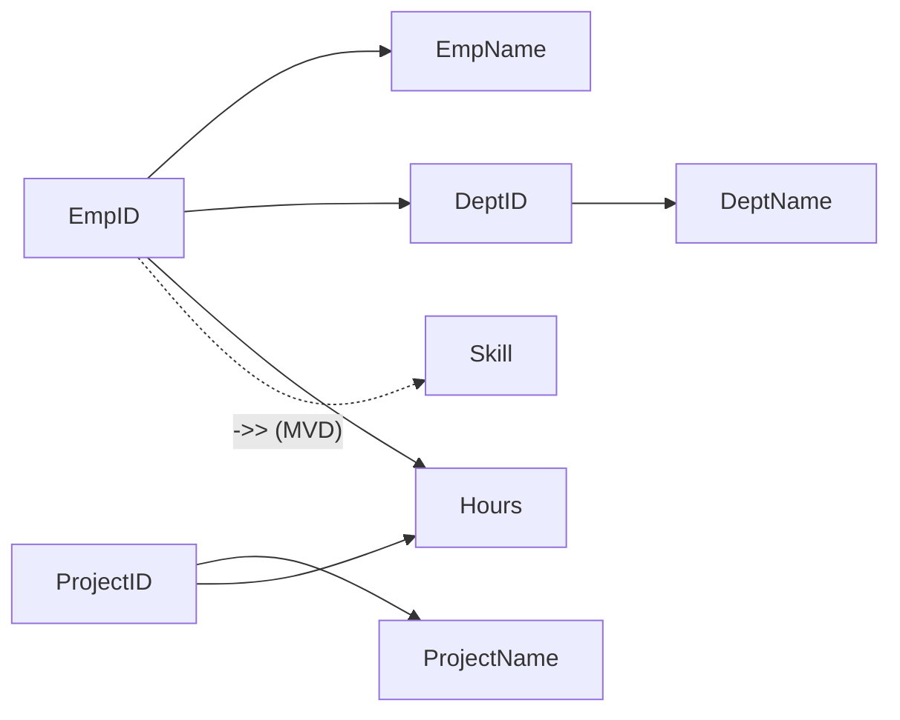
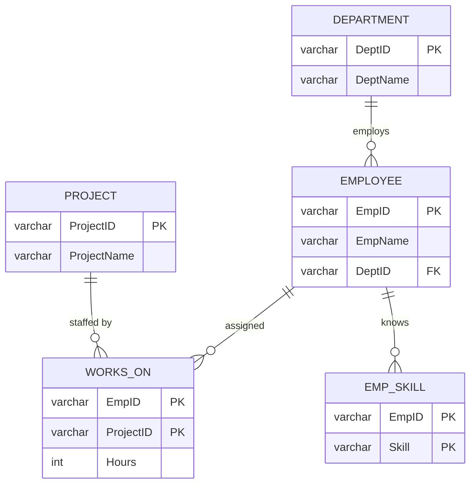

# 3C Employee_Project - step-by-step normalisation derivation (with the MVD)

`Employee_Project(EmpID, EmpName, DeptID, DeptName, ProjectID, ProjectName, Hours, Skills)`

| # | Dependency |
|---|---|
| F1 | EmpID -> EmpName, DeptID |
| F2 | DeptID -> DeptName |
| F3 | ProjectID -> ProjectName |
| F4 | {EmpID, ProjectID} -> Hours |
| M1 | EmpID ->> Skills (multivalued, not a functional dependency) |

## 1NF
`Skills` is not atomic ('Python, SQL'). Replace it by one row per skill => attribute `Skill`; 7 rows. Skill is not on the right side of any FD, so the key becomes **{EmpID, ProjectID, Skill}** (closure of the three attributes = everything; no two-attribute subset gives Skill).

## Anomalies
Insert: no department/project without an employee. Update: Ravi's department stored in 4 rows. Delete: removing Sneha's row loses D2/IT. Plus the MVD anomaly: adding a new skill to Ravi needs 2 new rows (one per project).

## Partial and transitive dependencies
* Partial: F1 (EmpID only), F3 (ProjectID only), F4 (needs only {EmpID, ProjectID}, a proper subset of the 3-column key).
* Transitive: EmpID -> DeptID -> DeptName (F1 + F2).

## 2NF
| Relation | Key |
|---|---|
| Employee(EmpID, EmpName, DeptID, DeptName) | EmpID |
| Project(ProjectID, ProjectName) | ProjectID |
| Works_On(EmpID, ProjectID, Hours) | {EmpID, ProjectID} |
| Emp_Skill(EmpID, Skill) | {EmpID, Skill} |

## 3NF / BCNF
Employee has the transitive F2 => split Department(DeptID, DeptName). Final: Department, Employee, Project, Works_On, Emp_Skill. All FD determinants (EmpID, DeptID, ProjectID, {EmpID, ProjectID}) are keys of their tables => **BCNF**.

## 4NF (the MVD)
A relation is in 4NF if every non-trivial MVD X ->> Y has X as a superkey. In EP_1NF `EmpID ->> Skill` holds but EmpID is not a key, so 4NF is violated: Python and SQL are repeated for each of Ravi's projects. Decomposing into Emp_Skill(EmpID, Skill) and Works_On(EmpID, ProjectID, Hours) removes this. Lossless because for the MVD R = (EmpID, Skill) ⋈ (EmpID, rest) (checked in `fd_analysis.py`: join of projections = 7 original rows).

## Final ER

