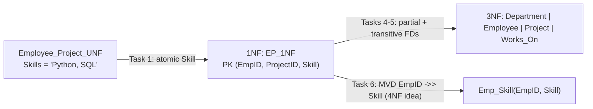

# Explanation - 3C Employee Project

## ER / structure diagram

## Concepts used

* **Atomicity**: Skills = 'Python, SQL' is a list, so the table is not in 1NF.
* **Multivalued dependency** `EmpID ->> Skill`: an employee's skills are independent of the projects he works on. Storing both in one relation forces every skill to be repeated for every project (and the other way round).
* **4NF idea**: a relation with two independent multivalued facts about the same key is split so that each fact has its own table (Emp_Skill and Works_On).
* Candidate key of the 1NF relation = {EmpID, ProjectID, Skill} because Skill is not determined by the other columns.

## Task-by-task logic

### Core tasks (from the PDF)

**Task 1 - Identify the non-atomic attribute and convert to atomic values (1NF)**  
Skills holds 'Python, SQL' / 'SQL, Tableau'. The 1NF table EP_1NF repeats the project row once per skill (7 rows instead of 4).

**Task 2 - Anomalies in the original table**  
INSERT: a new project PR9 or a new department D3 cannot be stored without an employee (EmpID part of the key) -> error. UPDATE: department of Ravi stored in 2 rows (4 in 1NF); changing 1 row leaves D1 with two names. DELETE: deleting Sneha's only row deletes the fact that department D2 is called IT.

**Task 3 - Find the candidate key**  
EmpID+ = {EmpID, EmpName, DeptID, DeptName}; {EmpID,ProjectID}+ adds ProjectName and Hours but not Skill; Skill is on the right of no FD, so every key must contain it => the only candidate key is {EmpID, ProjectID, Skill} (fd_analysis.py).

**Task 4 - Partial and transitive dependencies**  
Partial: EmpID -> EmpName, DeptID (EmpID is only part of the key); ProjectID -> ProjectName; {EmpID,ProjectID} -> Hours is partial w.r.t. the 3-column key (Skill missing). Transitive: EmpID -> DeptID -> DeptName.

**Task 5 - Normalise to 2NF and 3NF**  
2NF: Employee(EmpID, EmpName, DeptID, DeptName), Project(ProjectID, ProjectName), Works_On(EmpID, ProjectID, Hours), Emp_Skill(EmpID, Skill). 3NF: split Department(DeptID, DeptName) out of Employee. (Tables are created in Task 7.)

**Task 6 - BCNF check and the multivalued dependency EmpID ->> Skills (4NF idea)**  
All FD determinants are keys of the final tables => BCNF. But EP_1NF still stores Python/SQL for Ravi twice (once per project): that redundancy is not caused by an FD but by the MVD EmpID ->> Skill (skills are independent of projects). Fix: Emp_Skill(EmpID, Skill) separate from Works_On. The query shows the repetition.

**Task 7 - Create the tables in SQL with keys**  

**Task 8 - Insert the data**  

**Task 9 - Employees with total project hours**  
Ravi 20+15 = 35, Sneha 30, Amol 25.

**Task 10 - Each project with the employees working on it**  
GROUP_CONCAT collapses the employee names of one project into one cell (Oracle: LISTAGG).

**Task 11 - Employees who know both Python and SQL**  
Group the skill rows per employee and require both skills to be present. Only Ravi.

**Task 12 - Department with the highest total project hours**  
R&D: Ravi 35 + Amol 25 = 60; IT: Sneha 30.

### Advanced / examiner-style queries

**Adv 1 - Reconstruct the 1NF table (lossless-join check)**  
Joining Employee-Department-Works_On-Project-Emp_Skill gives 7 rows, identical to EP_1NF.

**Adv 2 - Add a skill for Sneha without touching any project row**  
With Emp_Skill the MVD no longer forces extra project rows.

**Adv 3 - In EP_1NF the same change needs one row per project**  
Sneha works on one project only, but Ravi (2 projects) adding a skill 'Docker' would need 2 new rows:

**Adv 4 - Employees without any project**  

**Adv 5 - Duplicate skill for the same employee**  
Error 1062: the composite key (EmpID, Skill) prevents it.

**Adv 6 - Negative hours**  
Error 3819.
