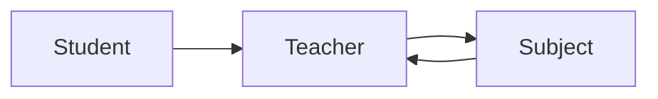
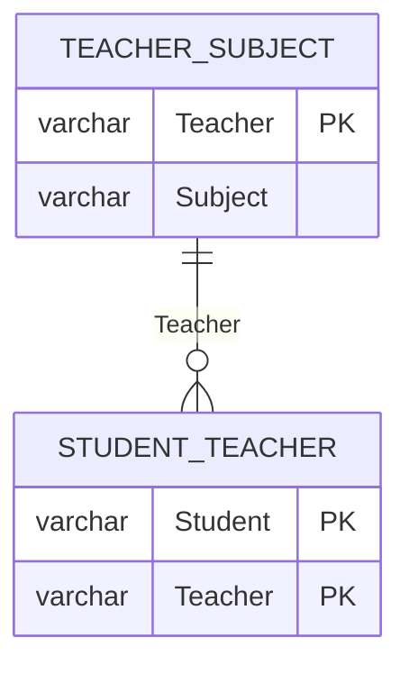

# 3D Teaching - 3NF but not BCNF: derivation

`Teaching(Student, Subject, Teacher)`  FDs: **F1** {Student, Subject} -> Teacher, **F2** Teacher -> Subject

## 1. Candidate keys (closures)
| Set | Closure | Key? |
|---|---|---|
| {Student} | {Student} | no |
| {Teacher} | {Teacher, Subject} | no |
| {Student, Subject} | + Teacher (F1) = all | **yes** (minimal) |
| {Student, Teacher} | + Subject (F2) = all | **yes** (minimal) |
| {Subject, Teacher} | {Subject, Teacher} | no |

Candidate keys: **{Student, Subject}**, **{Student, Teacher}**.

## 2. Prime / non-prime
Prime: Student, Subject, Teacher. Non-prime: none.

## 3. 2NF, 3NF
No non-prime attributes => no partial or transitive dependency of a non-prime attribute => **2NF and 3NF hold**. For F2 (Teacher -> Subject, Teacher not a superkey) 3NF is saved by the clause "Subject is a prime attribute".

## 4. BCNF violation
F2: determinant Teacher is not a superkey (Teacher+ = {Teacher, Subject}). Therefore the relation is **not in BCNF**. Effect: 'Kale teaches DBMS' is stored once per Kale student; if Kale switches subject all of his rows must change (update anomaly), a teacher with no student cannot be stored (insert anomaly).

## 5. Decomposition (BCNF)
Split on the violating FD Teacher -> Subject:

| R1 | Teacher_Subject(Teacher, Subject) | key Teacher |
| R2 | Student_Teacher(Student, Teacher) | key {Student, Teacher}, FK Teacher |

Both are in BCNF (their only determinant is the key).

## 6. Lossless? Dependency preserving?
* R1 ∩ R2 = {Teacher}, which is a key of R1 => **lossless** (chase: True).
* F2 lives in R1 (preserved). F1 = {Student, Subject} -> Teacher needs Student (only in R2) and Subject (only in R1) => **F1 is lost** (closure test: `Dependency preserving : False`). Consequence: the decomposed schema accepts Asha with two DBMS teachers (ADV 1).

> General lesson: 3NF decomposition can always be both lossless and dependency preserving; BCNF decomposition is always lossless but not always dependency preserving.

## 7. Final ER

