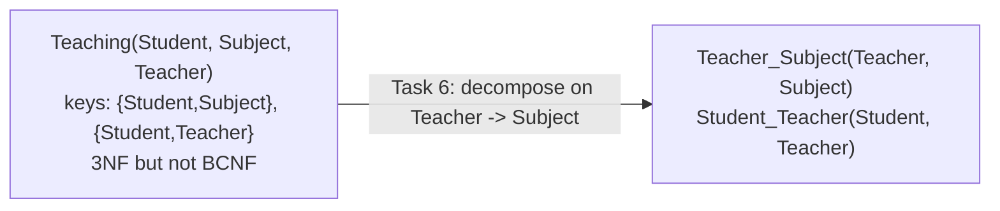

# Explanation - 3D Teaching

## ER / structure diagram

## Concepts used

* **Prime attribute** = member of some candidate key. 3NF allows `X -> A` when A is prime; **BCNF does not** - X must be a superkey.
* Here {Student, Subject} and {Student, Teacher} are both keys, so all three attributes are prime => 2NF and 3NF hold trivially. Teacher -> Subject has a non-key determinant => BCNF fails.
* BCNF decomposition is always lossless, but it may **lose a functional dependency**: {Student, Subject} -> Teacher can no longer be enforced inside one table.

## Task-by-task logic

### Core tasks (from the PDF)

**Task 1 - All candidate keys**  
{Student,Subject}+ = all; {Student,Teacher}+ = {Student,Teacher,Subject} (Teacher -> Subject) = all; {Student}+, {Subject,Teacher}+ are not. Candidate keys: {Student, Subject} and {Student, Teacher}. Data check: both pairs are unique over the 5 rows.

**Task 2 - Prime and non-prime attributes**  
Prime: Student, Subject, Teacher (each belongs to a candidate key). Non-prime: none.

**Task 3 - 2NF and 3NF with justification**  
2NF: needs a non-prime attribute depending on part of a key - there are no non-prime attributes, so 2NF holds. 3NF: every attribute is prime, so the 3NF condition "dependent attribute is prime" is satisfied for Teacher -> Subject (Subject is prime). Hence the relation is in 3NF. Check that the FD Teacher -> Subject holds on the data (empty = holds):

**Task 4 - Prove the relation violates BCNF**  
Teacher -> Subject is non-trivial and Teacher+ = {Teacher, Subject} is not all attributes, so Teacher is not a superkey. Consequence (redundancy): the fact 'Prof. Kale teaches DBMS' is stored once for every student of Kale.

**Task 5 - Update anomaly when Prof. Kale switches subject**  
Kale switches from DBMS to DAA. All rows of Kale must change (2 rows); updating only one leaves Kale teaching two subjects, breaking Teacher -> Subject.

**Task 6 - Decompose into BCNF**  
Take the violating FD Teacher -> Subject: R1(Teacher, Subject) with key Teacher and R2(Student, Teacher) = R minus the dependent attribute.

**Task 7 - Is the decomposition lossless?**  
Yes: R1 ∩ R2 = {Teacher}, and Teacher is a key of R1 (Teacher -> Subject). Proof on data: the natural join returns exactly the 5 original rows.

**Task 8 - Is it dependency preserving? Which FD is lost?**  
The FD {Student, Subject} -> Teacher spans both tables (Student only in R2, Subject only in R1) so no table can enforce it. Demonstration (after Task 9 the tables exist): Asha can be given a second DBMS teacher, which the old table forbade (PK Student, Subject). See the "lost dependency" demo in ADV 1. Python proof: fd_analysis.py => 'Dependency preserving : False, lost: {Student, Subject}->{Teacher}'.

**Task 9 - Create the BCNF tables in SQL**  

**Task 10 - Insert the data into them**  

**Task 11 - JOIN that lists each student, subject and teacher**  

**Task 12 - Teachers with the number of students they teach**  
Kale 2 (Asha, Bhushan), Joshi 2 (Asha, Chetan), Mane 1 (Chetan).

### Advanced / examiner-style queries

**Adv 1 - The lost dependency {Student, Subject} -> Teacher in action**  
The decomposed schema happily accepts a second DBMS teacher (Prof. Mane) for Asha, which the original PK (Student, Subject) would have rejected. The violation is only visible after a join (two teachers for one student+subject). This is the price of BCNF.

**Adv 2 - The same insert on the original relation is rejected**  
Error 1062 on (Student, Subject): the old design enforced the FD.

**Adv 3 - Kale switches subject - ONE row update in the BCNF design**  

**Adv 4 - A teacher without students can now be stored**  

**Adv 5 - Students taking more than one subject**  

**Adv 6 - Student of an unknown teacher**  
Error 1452.
