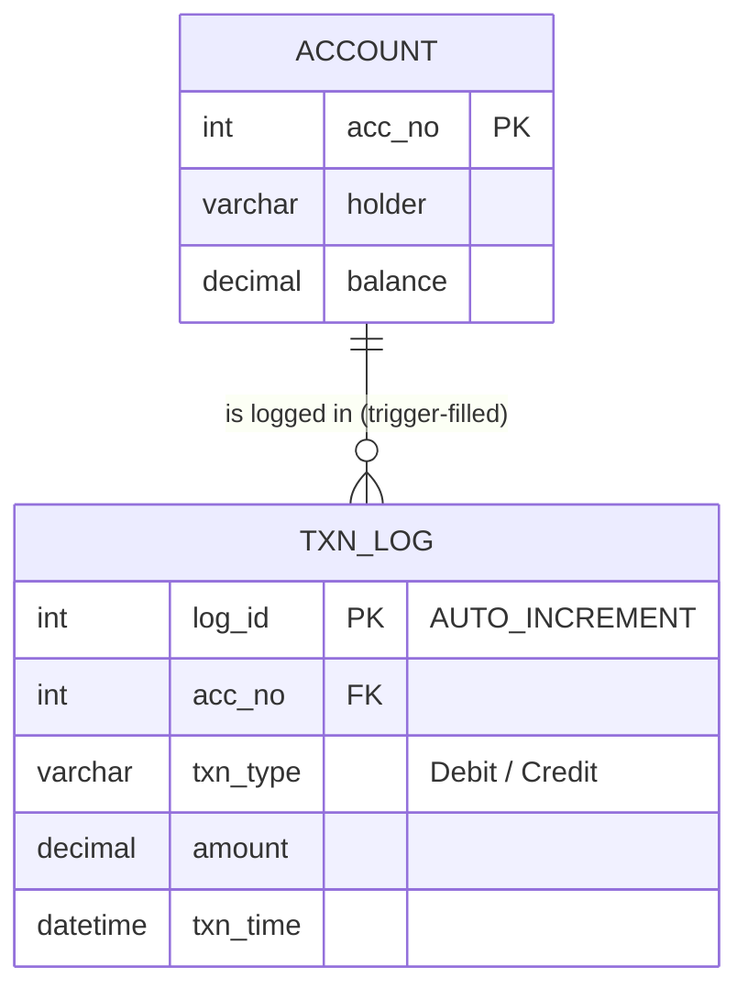

# Explanation - 4A Bank Transfer

## ER / structure diagram

## Concepts used

* **Trigger**: code that fires automatically BEFORE/AFTER INSERT, UPDATE or DELETE on a table; `NEW` / `OLD` give the new / old row.
* **SIGNAL SQLSTATE '45000'** raises a user-defined error and aborts the statement (and the trigger's triggering statement).
* **Stored procedure** (`CALL`, IN/OUT parameters) vs **stored function** (returns one value, usable inside SELECT). Functions need `READS SQL DATA` (or DETERMINISTIC / NO SQL) when binary logging is on.
* **Transaction**: START TRANSACTION ... COMMIT / ROLLBACK. An `EXIT HANDLER FOR SQLEXCEPTION` that does ROLLBACK + RESIGNAL makes the procedure all-or-nothing.
* **ACID**: Atomicity (rollback of half a transfer), Consistency (CHECK/trigger/min balance), Isolation (other sessions do not see uncommitted data), Durability (committed data survives a crash/restart - InnoDB redo log).
* Oracle PL/SQL differences: `CREATE OR REPLACE TRIGGER ... :NEW.balance`, `RAISE_APPLICATION_ERROR(-20001, 'msg')`, `EXCEPTION WHEN OTHERS THEN ROLLBACK`.

## Task-by-task logic

### Core tasks (from the PDF)

**Task 1 - Create Account and Txn_Log and insert the data**  
Tables and rows were created by 01_schema.sql / 02_sample_data.sql; Txn_Log is empty.

**Task 2 - AFTER UPDATE trigger that logs every balance change (Debit / Credit)**  
Fires after each UPDATE of Account; compares OLD.balance and NEW.balance and inserts the difference with the direction.

**Task 3 - BEFORE UPDATE trigger that blocks a balance below 1000**  
SIGNAL raises SQLSTATE 45000 with a message; the UPDATE is cancelled and nothing is logged.

**Task 4 - Procedures deposit(acc, amt) and withdraw(acc, amt)**  
Both validate the amount and the account; the min-balance trigger from Task 3 protects withdraw. Tested inside a transaction that is rolled back, so the PDF's starting balances are unchanged (note: AUTO_INCREMENT values used by the rolled-back log rows are NOT given back - gaps in log_id are normal).

**Task 5 - transfer_funds(IN from_acc, IN to_acc, IN amt) inside START TRANSACTION ... COMMIT, ROLLBACK if insufficient**  
SELECT ... FOR UPDATE locks the source row. If funds are short we SIGNAL; the EXIT HANDLER rolls back and re-raises the error to the caller. "Insufficient" also covers the 1000 minimum balance rule (balance after debit must stay >= 1000).

**Task 6 - Call transfer_funds(1001, 1002, 10000) and show both tables**  
1001: 50000 -> 40000, 1002: 20000 -> 30000. The AFTER UPDATE trigger logs one Debit and one Credit of 10000. log_id starts at 4 and not 1 because ids 1-3 were consumed by log rows of the rolled-back tests in Tasks 2 and 4 (AUTO_INCREMENT is never rolled back).

**Task 7 - transfer_funds(1003, 1001, 8000) - rollback, balances unchanged (atomicity, consistency)**  
Kiran has 5000; 5000 - 8000 < 1000, so the procedure signals "Insufficient balance" and the handler ROLLBACKs. Nothing changes and nothing is logged.

**Task 8 - Function get_balance(acc) and its use in SELECT**  
A function returns one scalar and can be used in any expression. READS SQL DATA tells MySQL it only reads tables.

**Task 9 - Procedure mini_statement(acc) - last 5 transactions**  
ORDER BY log_id DESC LIMIT 5 returns the newest entries first.

**Task 10 - Isolation - transfer in one session, read from another before COMMIT**  
Needs two real connections, therefore executed by run_demo.py (see the "Multi-session demonstration" section further down this file and session1.sql / session2.sql). Under REPEATABLE READ (default) S2 keeps seeing the OLD balances until S1 commits, and S2's UPDATE on the same row waits for S1's row lock.

**Task 11 - Commit a transfer, restart the server, show it persists (durability)**  
Needs a server restart; follow DURABILITY.md (steps + real captured output). InnoDB writes the redo log at COMMIT (innodb_flush_log_at_trx_commit = 1), so after a crash/restart the committed transfer is replayed from the redo log.

**Task 12 - Drop a trigger and show that logging stops**  
After DROP TRIGGER trg_account_log, balance updates still work but Txn_Log no longer grows. (Remember to re-create the trigger if you continue the experiment.)

### Advanced / examiner-style queries

**Adv 1 - Re-create the logging trigger and prove it works again**  

**Adv 2 - Invalid transfers - same account, negative amount, unknown source**  
Each call fails with the message set by SIGNAL and changes nothing.

**Adv 3 - Transfer to a non-existent destination is rolled back (debit undone)**  
The credit UPDATE touches 0 rows -> SIGNAL -> handler ROLLBACK, so the already executed debit is undone.

**Adv 4 - Consistency check - total money in the bank never changes by a transfer**  

**Adv 5 - Function in a WHERE clause**  

**Adv 6 - Net movement per account from the log**  

