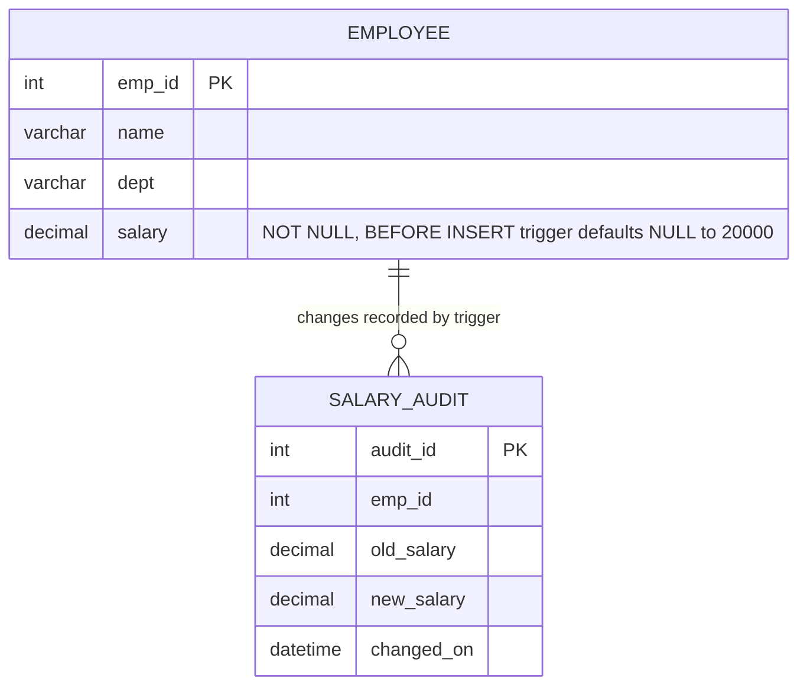

# Explanation - 4B Payroll

## ER / structure diagram

## Concepts used

* **BEFORE UPDATE** trigger = validation (SIGNAL to reject); **AFTER UPDATE** trigger = audit trail; **BEFORE INSERT** trigger can rewrite `NEW` values (default NULL salary to 20000).
* **Cursor**: `DECLARE c CURSOR FOR SELECT ...; OPEN c; FETCH c INTO ...; CLOSE c;` with `DECLARE CONTINUE HANDLER FOR NOT FOUND SET done = 1` to end the loop.
* **Handlers**: `DECLARE EXIT/CONTINUE HANDLER FOR SQLEXCEPTION|SQLSTATE|NOT FOUND` ; `GET DIAGNOSTICS CONDITION 1 msg = MESSAGE_TEXT` reads the error text.
* **OUT parameters** return values to the caller through session variables: `CALL dept_stats('IT', @t, @a)`.
* Assumption for Task 9: the salary column is the **monthly** salary, so annual = salary x 12; tax is a slab: 0% up to 5,00,000 and 10% of the part above 5,00,000.
* Oracle: use `RAISE_APPLICATION_ERROR`, `FOR rec IN (SELECT ...) LOOP ... END LOOP;` for cursors, `OUT` params with bind variables.

## Task-by-task logic

### Core tasks (from the PDF)

**Task 1 - Create Employee and insert the data**  

**Task 2 - Create table Salary_Audit (emp_id, old_salary, new_salary, changed_on)**  
Created in 01_schema.sql; changed_on defaults to the current time.

**Task 3 - BEFORE UPDATE trigger that raises an error if the new salary is lower than the old one**  
SIGNAL SQLSTATE 45000 aborts the UPDATE with the given message.

**Task 4 - AFTER UPDATE trigger that records every salary change in Salary_Audit**  
Only when the salary actually changed (NEW.salary <> OLD.salary), so updating other columns does not create audit rows.

**Task 5 - BEFORE INSERT trigger that sets salary to 20000 if inserted as NULL**  
The column is NOT NULL, but a BEFORE trigger runs before the NOT NULL check, so replacing NEW.salary makes the INSERT legal. The new row is rolled back afterwards so later tasks see the five rows of the PDF.

**Task 6 - Procedure give_raise(IN d, IN pct) with a cursor that prints each new salary**  
The cursor loops over the employees of one department; each iteration raises the salary and SELECTs a message (a "print").

**Task 7 - Call give_raise('IT', 10) and display Employee and Salary_Audit**  
Anil 60000 -> 66000, Bharti 55000 -> 60500; the AFTER UPDATE trigger writes two audit rows.

**Task 8 - Reduce Chirag's salary to 30000 - trigger error**  
30000 < 40000, so trg_emp_no_decrease signals "Salary cannot be reduced"; the row keeps 40000 and no audit row is written.

**Task 9 - Function annual_tax(emp_id) - 0% up to 5,00,000 annual, 10% above; list every employee with tax**  
annual = monthly salary x 12; tax = 10% of (annual - 500000) when annual > 500000. Anil 792000 -> 29200, Bharti 726000 -> 22600, Deepa 504000 -> 400, others 0.

**Task 10 - Procedure dept_stats(IN d, OUT total, OUT avg_sal) and call it**  
OUT parameters are filled by the procedure and read back through user variables in the same session.

**Task 11 - Exception handling (DECLARE ... HANDLER) in give_raise for an invalid department**  
The new version first checks that the department exists and SIGNALs otherwise; an EXIT HANDLER catches any SQL exception, reads its text with GET DIAGNOSTICS and returns it as a normal result instead of an error. Valid departments behave exactly as before.

**Task 12 - Run give_raise inside a transaction and ROLLBACK; salaries are restored**  
The procedure itself does not commit, so the caller controls the transaction: the raise (and its audit rows) disappear on ROLLBACK.

### Advanced / examiner-style queries

**Adv 1 - Total tax payable by the company**  

**Adv 2 - Highest paid employee of each department using a correlated subquery**  

**Adv 3 - Audit trail with the percentage change**  

**Adv 4 - Equal salary update is allowed and creates no audit row**  
The BEFORE trigger only rejects a LOWER salary; the AFTER trigger logs only real changes.

**Adv 5 - Trigger rejecting a decrease also protects bulk updates**  
The whole UPDATE fails and is rolled back as one statement, no employee is changed.

**Adv 6 - Dept_stats for an unknown department returns NULLs (no error)**  

