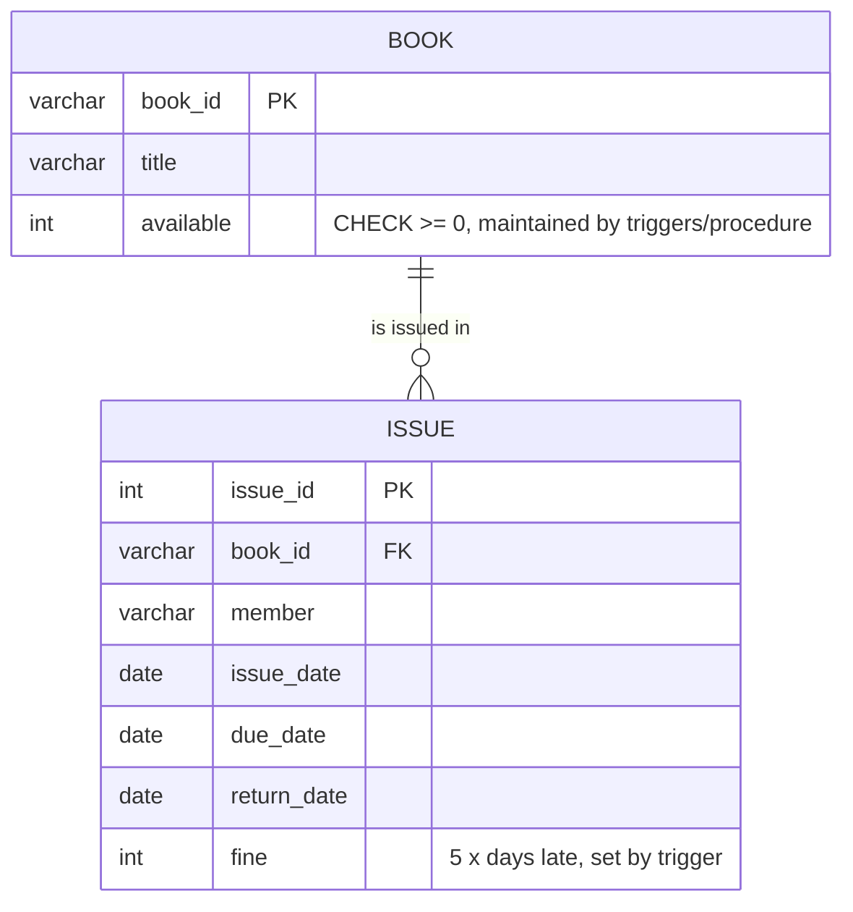

# Explanation - 4C Library Fines

## ER / structure diagram

## Concepts used

* A **BEFORE UPDATE** trigger may modify `NEW` (here: compute the fine) - that is its main advantage over an AFTER trigger.
* Fine rule: 5 x number of days between due_date and return_date when the book comes back late (never negative).
* **SAVEPOINT**: a named point inside a transaction; `ROLLBACK TO SAVEPOINT x` undoes only the work after x, the transaction stays open and `COMMIT` keeps the rest.
* **Row-count rule** as a trigger: BEFORE INSERT counts the member's unreturned books and SIGNALs when the limit (3) is reached.
* `SHOW TRIGGERS`, `SHOW PROCEDURE STATUS`, `DROP PROCEDURE` are the metadata commands for stored code.

## Task-by-task logic

### Core tasks (from the PDF)

**Task 1 - Create Book and Issue and insert the data**  

**Task 2 - BEFORE UPDATE trigger on Issue: fine = 5 x days late when return_date is filled**  
Fires only when return_date goes from NULL to a date. GREATEST(..., 0) avoids negative fines for early returns.

**Task 3 - AFTER UPDATE trigger that increments available when a book is returned**  

**Task 4 - Procedure issue_book(IN b, IN m): check availability, insert with due_date = issue_date + 14 days, decrement available; error if 0**  
FOR UPDATE locks the book row so two members cannot take the last copy at the same time.

**Task 5 - Return book 1 on 2026-10-20 and show the fine**  
Due 2026-10-15, returned 2026-10-20 = 5 days late => fine 25. The AFTER trigger raises B1.available from 2 to 3.

**Task 6 - Call issue_book('B3','Sneha') and show the error**  
B3 has 0 copies available, so the procedure signals 'Book not available' and inserts nothing.

**Task 7 - Function total_fine(member) returning the fine paid by a member**  

**Task 8 - Procedure overdue_list() with a cursor: books not returned past the due date**  
Loops over unreturned issues whose due_date is before today and prints one line per book. (Output depends on today's date.)

**Task 9 - Transaction: issue B1 and B2 to Sneha, SAVEPOINT after B1, ROLLBACK TO the savepoint, COMMIT**  
Only the B1 issue survives: B1.available goes 3 -> 2, B2.available stays 1 because its issue and decrement were rolled back.

**Task 10 - Trigger that blocks issuing more than 3 books to one member**  
BEFORE INSERT counts the member's unreturned books; with 3 already out the 4th INSERT is rejected before it is written. Sneha already holds B1 (Task 9); two more are issued, the next one is blocked. Run in a transaction that is rolled back.

**Task 11 - Show all triggers with SHOW TRIGGERS**  

**Task 12 - Drop procedure overdue_list and verify**  
After DROP PROCEDURE the routine disappears from the catalogue and calling it fails with error 1305.

### Advanced / examiner-style queries

**Adv 1 - Early return gives no fine**  

**Adv 2 - A return date is filled only once - second update does not re-charge the fine**  
The trigger condition OLD.return_date IS NULL protects against double counting; B1.available is also not incremented twice.

**Adv 3 - Members and the number of unreturned books they hold**  

**Adv 4 - Return an Issue record for a book to make it available again, then issue B3 successfully**  

**Adv 5 - CHECK stops available from going negative even if the procedure is bypassed**  
Error 3819.

**Adv 6 - Fine report per member**  

