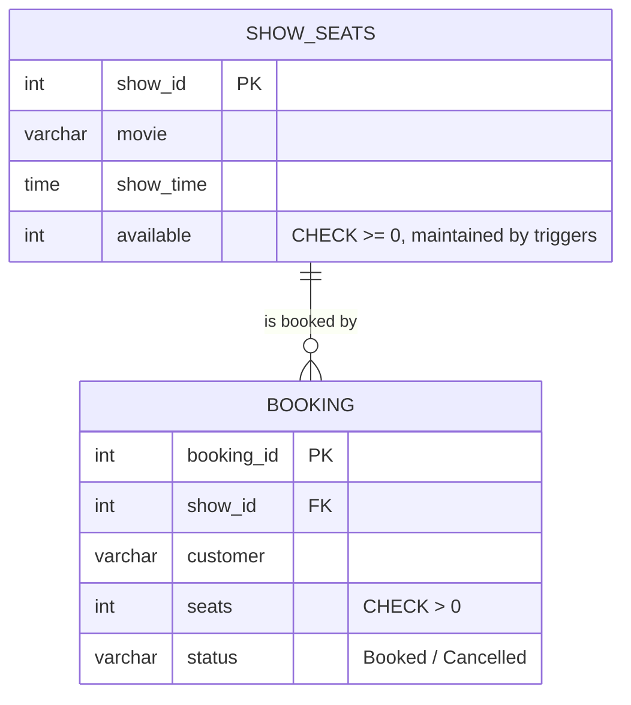

# Explanation - 4D Ticket Booking

## ER / structure diagram

## Concepts used

* Three triggers keep `available` consistent: BEFORE INSERT (guard), AFTER INSERT (reserve), AFTER UPDATE (restore on cancellation).
* Procedure `book_ticket` wraps the booking in a transaction with an exit handler: success = COMMIT, any error = ROLLBACK + error to the caller.
* **SAVEPOINT** inside a transaction lets one booking be undone without losing the previous one.
* **Atomicity** = all or nothing (rollback, killed session); **Consistency** = `available + booked seats = capacity` always; **Isolation** = other sessions do not see uncommitted bookings; **Durability** = committed bookings survive (see 4A durability demo).

## Task-by-task logic

### Core tasks (from the PDF)

**Task 1 - Create Show_Seats and Booking and insert the data**  

**Task 2 - AFTER INSERT trigger on Booking that reduces available by seats**  

**Task 3 - AFTER UPDATE trigger that restores seats when status changes to 'Cancelled'**  
The condition OLD.status <> 'Cancelled' prevents restoring the same seats twice.

**Task 4 - BEFORE INSERT trigger that blocks booking when seats > available**  
The guard reads the current availability; if the request is bigger it SIGNALs and the INSERT never happens.

**Task 5 - Book 2 seats for show 1, then try 2 more - error**  
Show 1 has 3 seats. After the first booking 1 seat is left, so a request for 2 is rejected by trg_booking_guard.

**Task 6 - Cancel the first booking and show seats restored**  
Changing status to 'Cancelled' fires trg_booking_cancel: available 1 -> 3.

**Task 7 - Procedure book_ticket(show, cust, n) as a transaction**  
START TRANSACTION, INSERT (the triggers reserve the seats), COMMIT. Any error (guard trigger, unknown show, CHECK) triggers the handler: ROLLBACK + RESIGNAL.

**Task 8 - Function revenue(show_id) at 200 per seat**  
Only 'Booked' rows count, cancelled bookings earn nothing. Show 2: 4 seats x 200 = 800; show 1: 0 (its only booking was cancelled).

**Task 9 - Procedure show_report() printing seats booked and available per show using a cursor**  

**Task 10 - Two bookings in one transaction with a SAVEPOINT between; roll back the second**  
Both inserts reduce seats of show 2 (46 -> 44 -> 41); ROLLBACK TO SAVEPOINT undoes only the second one (and its seat reduction made by the trigger).

**Task 11 - Transaction with two bookings, kill the session before COMMIT, reconnect - nothing saved (atomicity)**  
A killed/disconnected session is rolled back by the server. This needs two connections, so it is done by run_demo.py (see the multi-session section below).

**Task 12 - How each ACID property was demonstrated (evidence queries)**  
A: Task 5 failed booking left no row, Task 10 savepoint rollback, Task 11 killed session.  C: CHECK(available>=0) + guard trigger => the invariant below holds. I: Task 11 second connection saw nothing of the uncommitted bookings (and 4A Task 10).  D: committed rows survive a restart (4A DURABILITY.md). Invariant check: available + booked seats must equal the original capacity (3 and 50) for every show.

### Advanced / examiner-style queries

**Adv 1 - Cancel an already cancelled booking - seats are NOT restored twice**  

**Adv 2 - Book exactly the remaining seats, then one more**  

**Adv 3 - Zero or negative seats**  
Error 3819 (chk_booking_seats) - the CHECK fires after the BEFORE trigger.

**Adv 4 - Invalid status value**  
Error 3819 (chk_booking_status).

**Adv 5 - Revenue of all shows combined**  

**Adv 6 - Booking for an unknown show**  
The FK / guard trigger refuses it (error 1644 'Show not found' from the guard).
