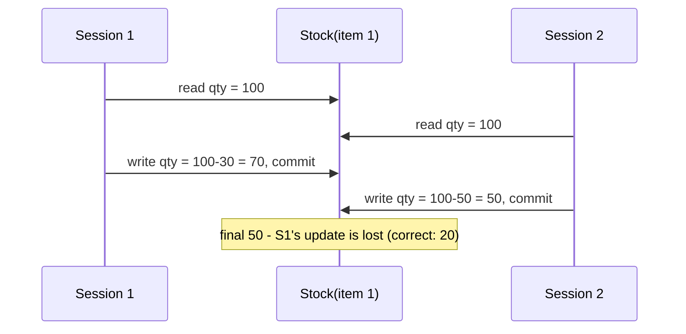

# Explanation - 5A Lost Update

## ER / structure diagram

## Concepts used

* **Lost update**: two transactions read the same value, both compute a new value from their stale read, the later write overwrites the earlier one.
* **Locks**: `FOR UPDATE` = exclusive (X) lock on the rows read; `LOCK IN SHARE MODE` / `FOR SHARE` = shared (S) lock (others may read, nobody may write); `LOCK TABLES t WRITE|READ` = table lock.
* `UPDATE t SET qty = qty - 30` is a single atomic read-modify-write inside the server, so it never loses an update.
* **Conflict serializability**: build the precedence graph (edge Ti -> Tj when an operation of Ti conflicts with a later one of Tj); a cycle means the schedule is not serializable.
* **Two-phase locking (2PL)**: a growing phase (acquire locks) then a shrinking phase (release). Strict 2PL holds X locks until COMMIT (what InnoDB does), guaranteeing serializable behaviour.
* A statement waiting for a lock fails after `innodb_lock_wait_timeout` seconds (default 50) with error 1205.

## Task-by-task logic

### Core tasks (from the PDF)

**Task 1 - Create Stock with InnoDB and insert the data; disable autocommit in both sessions**  
With autocommit ON every statement commits immediately, so no interleaving of two transactions would be possible.

**Task 2 - Check the current isolation level in both sessions**  
Default is REPEATABLE-READ.

**Task 3 - READ UNCOMMITTED in both; S1 reads qty, S2 reads qty, S1 sets 100-30, S2 sets 100-50, commit both**  
Both read 100. S1 writes 70 and commits; S2 (still working with its stale 100) writes 50 and commits. Final qty = 50, S1's -30 has vanished: LOST UPDATE.

**Task 4 - Schedule (time-line table) of the two transactions of Task 3**  
The time-line is printed by run_demo.py (table with one column per session): R1(X) R2(X) W1(X) C1 W2(X) C2.

**Task 5 - Reset qty to 100 and repeat with SELECT ... FOR UPDATE in both sessions**  

**Task 6 - Reset and repeat using UPDATE Stock SET qty = qty - 30 (atomic read-modify-write) and compare**  
Both transactions issue a relative update; the second waits for the first row lock and then applies its decrement to the new value: 100 - 30 - 50 = 20.

**Task 7 - LOCK IN SHARE MODE in S1: S2 can read but not update**  

**Task 8 - LOCK TABLES Stock WRITE in S1: S2 is blocked until UNLOCK TABLES**  

**Task 9 - LOCK TABLES Stock READ: S1 itself cannot update**  

**Task 10 - Lock-wait timeout (innodb_lock_wait_timeout) by leaving S1 open**  
S1 holds the row lock without committing; S2 waits and fails with ERROR 1205 after the timeout (set to 2 s for the demo).

**Task 11 - Is the schedule of Task 3 conflict serializable? (precedence graph)**  
Operations: R1(X) R2(X) W1(X) W2(X). R2(X) before W1(X) gives T2 -> T1; R1(X) before W2(X) gives T1 -> T2: the graph has a cycle, so it is NOT conflict serializable. The Task 5 schedule (S2 only reads after S1's commit) produces only T1 -> T2: serializable (order T1, T2).

**Task 12 - How two-phase locking prevents the lost update**  
Under (strict) 2PL T2 must obtain an exclusive lock on X before reading it for update; T1 keeps its X lock until COMMIT, so T2's read happens after T1's write. The interleaving R1 R2 W1 W2 is impossible; only a serial-equivalent order (T1 then T2) can occur. SELECT ... FOR UPDATE is how the application asks InnoDB for that lock.

### Advanced / examiner-style queries

**Adv 1 - Lost update prevented with SERIALIZABLE instead of FOR UPDATE**  
Under SERIALIZABLE a plain SELECT becomes a locking read. Both sessions take S locks, both then want X locks => one of them is the deadlock victim (error 1213) and must retry.

**Adv 2 - Optimistic locking with a version column (no long locks)**  
ALTER TABLE Stock ADD COLUMN version INT NOT NULL DEFAULT 0;

**Adv 3 - Which statements take which locks?**  
SELECT (RR, plain)       : no lock, consistent snapshot read SELECT ... FOR SHARE     : shared (S) row lock          UPDATE / DELETE / SELECT ... FOR UPDATE : exclusive (X) row lock LOCK TABLES t READ|WRITE : table-level lock held by the session, released by UNLOCK TABLES (or session end)

**Adv 4 - Show who is waiting for whom**  
SELECT * FROM performance_schema.data_lock_waits;      SELECT * FROM sys.innodb_lock_waits\G
