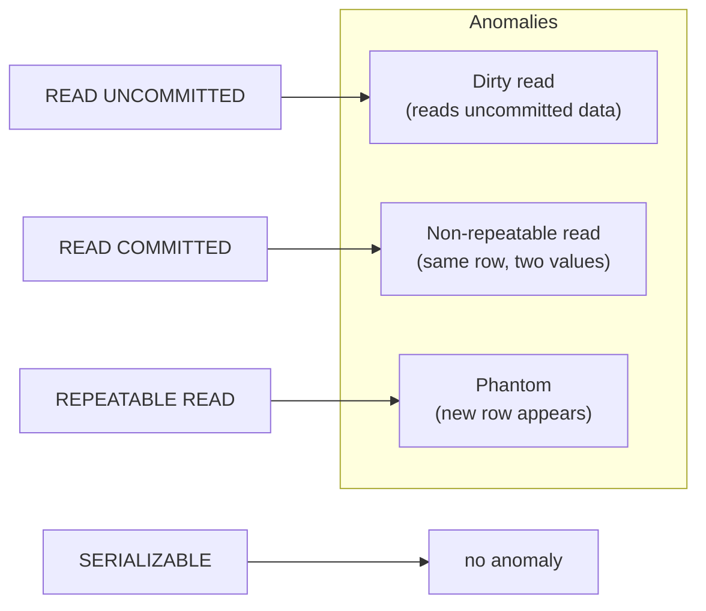

# Explanation - 5B Isolation Levels

## ER / structure diagram

## Concepts used

* **Dirty read**: reading another transaction's uncommitted change. **Non-repeatable read**: the same row read twice in one transaction gives different values (another transaction committed an UPDATE in between).
* **Phantom read**: the same range query returns additional rows (another transaction committed an INSERT).
* Levels: READ UNCOMMITTED (nothing prevented) < READ COMMITTED (no dirty read) < REPEATABLE READ (also no non-repeatable read; InnoDB default) < SERIALIZABLE (no anomaly, reads take locks).
* InnoDB detail: in REPEATABLE READ a *plain* SELECT uses one snapshot for the whole transaction, so phantoms do not show in plain reads; they appear in *locking/current* reads (`FOR UPDATE`, `FOR SHARE`) and after the transaction modifies rows itself.
* `SET SESSION TRANSACTION ISOLATION LEVEL x` affects the current session only (for its next transactions); `SET GLOBAL ...` affects only sessions opened afterwards.
* Preventing double booking: `SELECT ... FOR UPDATE` before the UPDATE (pessimistic lock) or a conditional `UPDATE ... WHERE status='Free'` and checking ROW_COUNT().

## Task-by-task logic

### Core tasks (from the PDF)

**Task 1 - Create Seats and insert the data; open two sessions**  
Seats A1 Free, A2 Free, A3 Booked.  Every task resets the data it changes.

**Task 2 - Display the isolation level with SELECT @@transaction_isolation**  

**Task 3 - Dirty read: S1 (no commit) sets A1 = 'Booked'; S2 under READ UNCOMMITTED reads A1; S1 rolls back**  
S2 sees 'Booked' for a seat that was never really booked: it read data that no longer exists (dirty read).

**Task 4 - Repeat Task 3 with S2 under READ COMMITTED: the dirty read is gone**  
S2 only sees committed data, so it keeps seeing 'Free' while S1's change is uncommitted.

**Task 5 - Non-repeatable read under READ COMMITTED**  
S2 reads A2 (Free), S1 books A2 and commits, S2 reads A2 again in the same transaction and gets Booked: the same query returned two different answers.

**Task 6 - Repeat Task 5 under REPEATABLE READ**  
S2 keeps reading its snapshot (Free) until it commits; the non-repeatable read is prevented.

**Task 7 - Phantom: S2 counts free seats twice while S1 inserts seat 'A4' - REPEATABLE READ**  
Plain SELECT COUNT(*) does not change (snapshot), but a locking read (FOR UPDATE) in the same transaction sees the committed A4: the phantom row. Under READ COMMITTED even the plain count changes.

**Task 8 - Repeat Task 7 under SERIALIZABLE: S1 is blocked**  
SERIALIZABLE turns S2's reads into shared locking reads with next-key (gap) locks, so S1's INSERT into the range must wait for S2's COMMIT.

**Task 9 - Two users book A2 at the same time - prevent double booking with SELECT ... FOR UPDATE**  
The first user locks the row; the second waits and, when it gets the row, sees 'Booked' and must refuse the booking.

**Task 10 - SET SESSION vs SET GLOBAL isolation level**  
SESSION changes only this connection. GLOBAL changes the default for NEW connections only; existing sessions keep their level. (The demo restores the global value.)

**Task 11 - Fill the table isolation level x anomaly (measured, not copied from a textbook)**  
run_demo.py runs the three anomaly experiments at all four levels with real sessions and prints the resulting occurred / prevented table.

**Task 12 - Recommend an isolation level for a seat-booking system and justify it**  
READ COMMITTED or REPEATABLE READ together with `SELECT ... FOR UPDATE` on the seat row (or a conditional UPDATE) - see the justification printed by run_demo.py.

### Advanced / examiner-style queries

**Adv 1 - Set the level for one transaction only**  

**Adv 2 - Phantom caused by the transaction's own write (REPEATABLE READ)**  

**Adv 3 - Optimistic booking without a lock**  

**Adv 4 - Which level does a mysqldump --single-transaction use?**  
REPEATABLE READ with START TRANSACTION WITH CONSISTENT SNAPSHOT: a consistent backup while the application keeps writing.

**Adv 5 - Statement that shows current locks**  
SELECT engine_transaction_id, object_name, lock_type, lock_mode, lock_data FROM performance_schema.data_locks;
