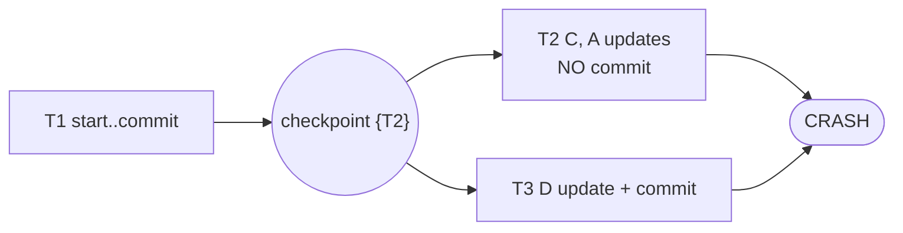

# Explanation - 5D Log-based recovery

## The log (`data/log.txt`)
```text
<T1, start> <T1, A, 1000, 950> <T1, B, 2000, 2050> <T1, commit>
<T2, start> <checkpoint {T2}>
<T2, C, 700, 600> <T3, start> <T3, D, 500, 800> <T3, commit> <T2, A, 950, 900>   --- crash ---
```
Update records are `<txn, item, old value, new value>`. The PDF writes record 5 as `<checkpoint {T2}> after <T2, start>`; the log file therefore has `<T2, start>` immediately **before** the checkpoint, which is the only reading in which T2 can be "active at the checkpoint".



## Rules used by the program
| Transaction | State at the crash | Immediate update | Deferred update |
|---|---|---|---|
| T1 | committed **before** the checkpoint | nothing (already on disk) | nothing |
| T2 | uncommitted (active) | **UNDO**: restore old values scanning the log backwards | ignore (never written to the database) |
| T3 | committed **after** the checkpoint | **REDO**: re-apply new values scanning forwards | **REDO** |

* **Immediate update**: the database is modified while the transaction runs, so uncommitted data may already be on disk -> needs UNDO (old values) and REDO (new values). The program assumes the worst case at the crash: *every* write reached the database (A=900, B=2050, C=600, D=800).
* **Deferred update**: writes go to the database only after the commit record is on disk -> no UNDO ever; crash state = only what was flushed by the checkpoint (A=950, B=2050, C=700, D=500).
* **Why UNDO scans backwards and REDO forwards**: if an item was changed several times by the same transaction, the *oldest* old value must win when undoing; the *newest* new value must win when redoing.
* **Checkpoint**: at a checkpoint committed data and the log are forced to disk, so recovery only has to consider transactions active at the checkpoint or started after it.

## Results
* Original log: both methods give **A=950, B=2050, C=700, D=800**.
* With `<T2, commit>` added: T2 is committed after the checkpoint -> REDO of T2 and T3 -> **A=900, B=2050, C=600, D=800**.

## Task 12 (MySQL)
`db_values(item, value)` receives the crash state; the recovery operations (UNDO/REDO results) are executed as parameterised `UPDATE`s inside **one transaction**, so the recovery itself is atomic.

## Oracle / design note
Real systems store LSNs in pages and use ARIES (analysis, redo, undo, compensation log records). This exercise implements the textbook simplified version required by the syllabus.
