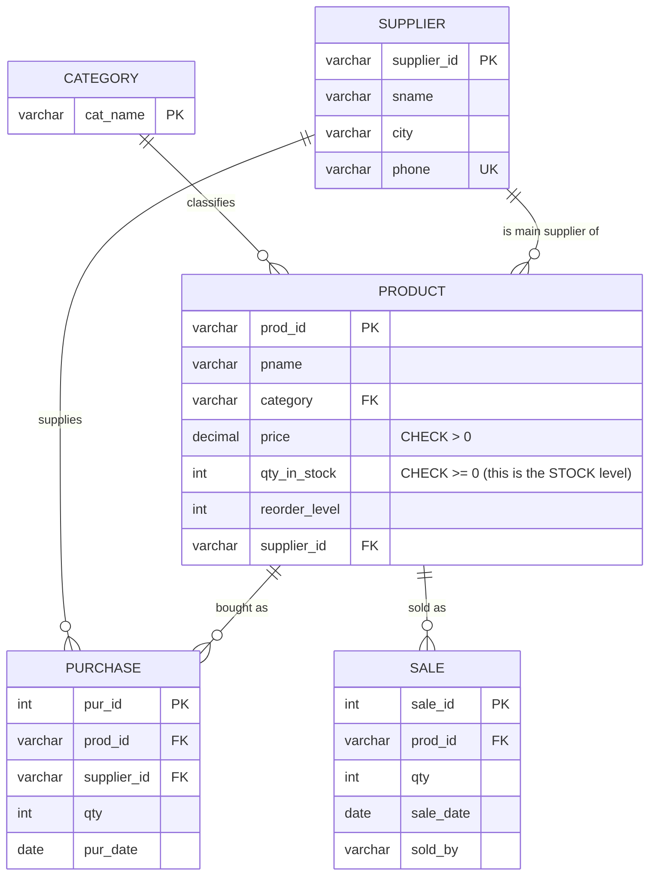

# Explanation - 6A Retail Store

## ER / structure diagram

## Concepts used

* **Stock maintenance by triggers**: AFTER INSERT on Purchase adds to `qty_in_stock`; BEFORE INSERT on Sale refuses a sale larger than the stock (SIGNAL); AFTER INSERT on Sale subtracts.
* **Triggers run with the privileges of their DEFINER**, so a clerk who may only INSERT into Sale still causes the stock update - no UPDATE right on Product is needed.
* **Reorder alert** = products with `qty_in_stock <= reorder_level`, joined to Supplier for the contact data.
* **RBAC in MySQL 8**: `CREATE ROLE`, `GRANT priv TO role`, `GRANT role TO user`, `SET DEFAULT ROLE` (a granted role is inactive until it is made default or `SET ROLE` is issued).
* **Column privilege** `UPDATE (price)` lets a manager change prices but nothing else. `SHOW GRANTS FOR user USING role` expands the role's privileges.
* Oracle: `CREATE ROLE clerk; GRANT INSERT ON Sale TO clerk; GRANT clerk TO clerk1;` (roles are enabled by default); triggers use `:NEW` and `RAISE_APPLICATION_ERROR`.

## Task-by-task logic

### Core tasks (from the PDF)

**Task 1 - ER diagram, tables with keys and constraints, data**  
The ER diagram is in 06_explanation.md. Product.category is a FK to Category; Purchase/Sale reference Product; CHECKs keep price > 0 and stock >= 0.

**Task 2 - AFTER INSERT trigger on Purchase adds qty to stock**  

**Task 3 - BEFORE INSERT trigger on Sale blocks the sale if stock is short**  
Reads the current stock; if NEW.qty is bigger it SIGNALs 'Insufficient stock' and the INSERT is rejected before anything is written.

**Task 4 - AFTER INSERT trigger on Sale reduces stock**  

**Task 5 - Insert purchase (P3, S2, 50) and sale (P2, 10) - show the result and the error**  
Purchase: A4 Paper stock 6 + 50 = 56. Sale of 10 monitors: stock is only 8, so the BEFORE trigger raises 'Insufficient stock' and stock stays 8. A valid sale (P1, 5) is added afterwards to show the AFTER trigger: Keyboard 40 -> 35.

**Task 6 - Products at or below reorder level with supplier name and phone**  
After task 5 the A4 paper is 56 (> 20); only the USB Drive (12 <= 15) needs re-ordering.

**Task 7 - Category-wise stock value (qty x price)**  

**Task 8 - Roles admin, store_manager, clerk and their privileges**  
admin: everything on the database; store_manager: read Product and change only price; clerk: read Product and record sales.

**Task 9 - Users mgr1 and clerk1 with their roles (SET DEFAULT ROLE)**  

**Task 10 - clerk1 tries UPDATE Product SET price = 800 (denied); mgr1 does it (allowed)**  
The clerk has no UPDATE privilege on Product at all: ERROR 1142. The manager holds UPDATE(price): allowed. As a safety measure the manager's statement is limited to one product (the PDF statement without WHERE would reprice everything); root then restores the price.

**Task 11 - SHOW GRANTS for each user**  

**Task 12 - REVOKE INSERT on Sale from clerk; clerk1 can no longer record a sale**  
Before the revoke clerk1 records a sale (stock of P4 drops 150 -> 147 although the clerk has no UPDATE right: the trigger runs as its definer). The privilege is removed from the ROLE, so every clerk loses it at once. The next INSERT by clerk1 is denied (ERROR 1142) while SELECT on Product still works.

### Advanced / examiner-style queries

**Adv 1 - Stock level equals purchases minus sales plus opening stock (reconciliation)**  
Opening values (from the PDF) + all purchases - all sales must equal qty_in_stock for every product.

**Adv 2 - Selling exactly the whole stock is allowed, one more is not**  

**Adv 3 - Zero or negative sale quantity**  
Error 3819 (chk_sale_qty).

**Adv 4 - Reorder suggestion: how many units to order to reach 2 x reorder level**  

**Adv 5 - Sales per user**  

**Adv 6 - Unknown product in a purchase**  
Error 1452 (fk_purchase_product).
