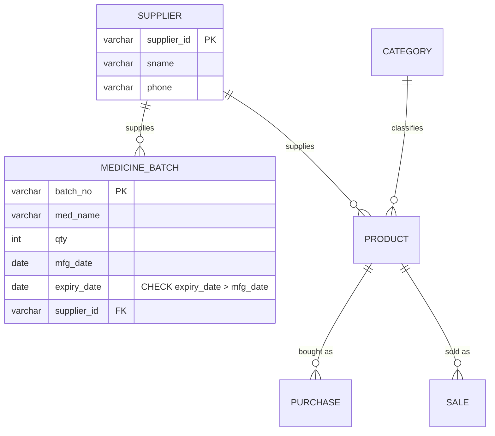

# Explanation - 6B Medical Store

## ER / structure diagram

## Concepts used

* **Batch/expiry management**: each delivery is a batch with manufacturing and expiry dates; sales must come only from non-expired batches.
* `CHECK (expiry_date > mfg_date)` guards data entry; a BEFORE INSERT trigger additionally refuses batches that are *already* expired (a CHECK cannot use CURRENT_DATE).
* Date windows: `expiry_date BETWEEN CURRENT_DATE AND CURRENT_DATE + INTERVAL 30 DAY` (Oracle: `SYSDATE + 30`).
* Per-group maximum: correlated subquery `qty = (SELECT MAX(qty) ... same supplier)`.
* **Privileges**: `GRANT SELECT ON view` exposes only the view's rows/columns. `UPDATE (qty)` alone is not enough for `SET qty = qty - 1 WHERE batch_no = ...` because reading columns needs SELECT.
* Procedures with OUT parameters return counts: `CALL delete_expired(@n); SELECT @n;`.

## Task-by-task logic

### Core tasks (from the PDF)

**Task 1 - Create Medicine_Batch with FK to Supplier and CHECK (expiry_date > mfg_date); insert the data**  

**Task 2 - Medicines expiring in the next 30 days**  
Window = today .. today + 30 days. With the run date shown in the output header this selects BT01 (2026-11-15) and BT03 (2026-11-05).

**Task 3 - Medicines already expired as of today**  
On the run date nothing is expired yet (earliest expiry 2026-11-05). To prove the query the same statement is evaluated "as of" 2026-12-01 using a variable.

**Task 4 - Supplier-wise total quantity supplied**  

**Task 5 - Batch with the maximum quantity for each supplier**  
Correlated subquery picks the largest qty of the same supplier: S1 -> BT01 (200 > 120), S2 -> BT02, S3 -> BT03.

**Task 6 - Trigger that blocks insertion of an already expired batch**  
BEFORE INSERT compares expiry_date with CURRENT_DATE (a CHECK constraint may not use it).

**Task 7 - Procedure that deletes expired batches and returns the count deleted**  
OUT parameter p_deleted = ROW_COUNT() of the DELETE. On the run date no batch is expired (returns 0); inside a transaction one batch is back-dated to show a deletion (then rolled back).

**Task 8 - sell_medicine(batch, qty): reduce qty, block sales from an expired batch**  
FOR UPDATE locks the batch row; checks existence, expiry and quantity; then reduces qty. Tested with a valid sale, too many units, and a back-dated (expired) batch.

**Task 9 - View low_stock (qty < 50)**  

**Task 10 - User pharmacist: SELECT on the view, UPDATE(qty) on Medicine_Batch**  
The pharmacist can read only the low-stock rows through the view and may change only qty. Because reading columns needs SELECT, an UPDATE that references qty or batch_no on the right-hand side / in WHERE is denied (ERROR 1143); a constant assignment without WHERE passes - a good argument for giving such users only procedures (sell_medicine) instead of column rights.

**Task 11 - User auditor with SELECT-only access on all tables; an INSERT is denied**  

**Task 12 - REVOKE privileges from pharmacist and drop the user**  

### Advanced / examiner-style queries

**Adv 1 - FEFO picking list (first expired, first out): batches ordered by expiry**  

**Adv 2 - Expiry status of every batch**  

**Adv 3 - Value at risk - quantity expiring within 30 days per supplier**  

**Adv 4 - Negative quantity**  
Error 3819 (chk_batch_qty).

**Adv 5 - Batch of an unknown supplier**  
Error 1452.

**Adv 6 - View is read-only for the auditor but the underlying data is the same**  
low_stock follows the data: after the sale of 5 units BT01 (200) is still not low stock, BT03 stays listed.
