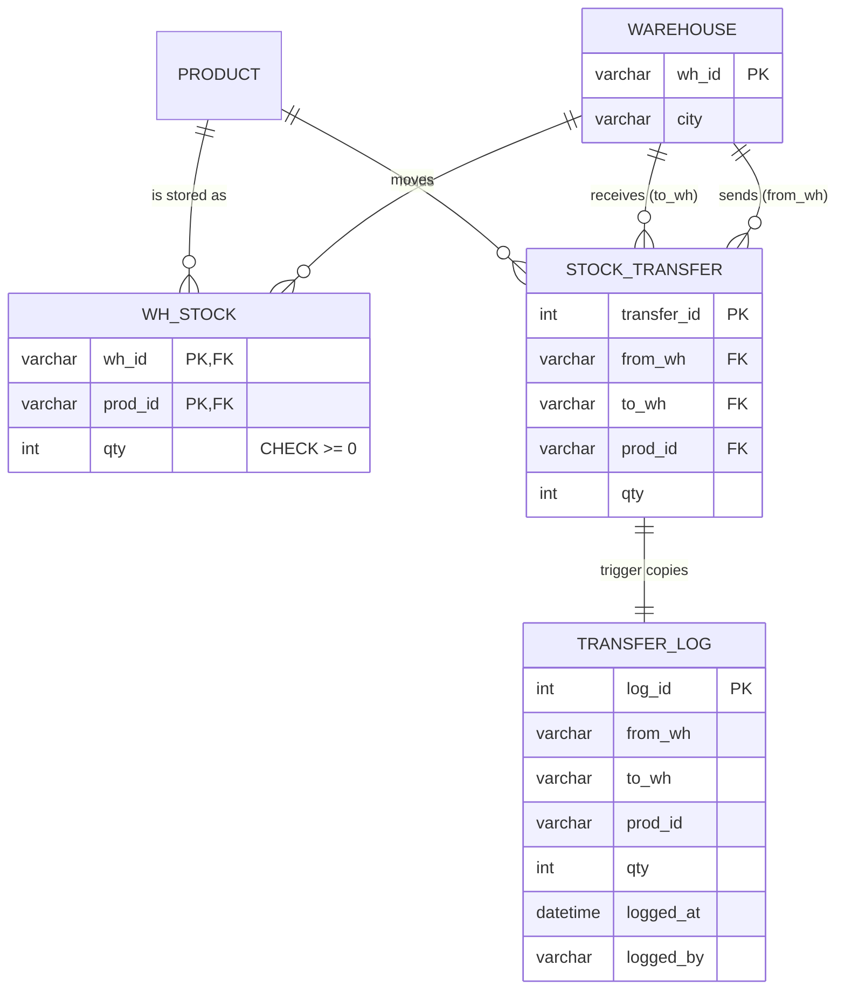

# Explanation - 6C Multi Warehouse

## ER / structure diagram

## Concepts used

* **Composite primary key** `(wh_id, prod_id)` in Wh_Stock: one row per product per warehouse.
* **Stock transfer** = decrease in the source row + increase (or creation) in the destination row; it must be ONE transaction so stock is neither lost nor created. `INSERT ... ON DUPLICATE KEY UPDATE` creates the destination row when it does not exist yet.
* **Transfer voucher + audit**: the procedure inserts a row into `Stock_Transfer`; the AFTER INSERT trigger copies it into `Transfer_Log` with the user and time. A rolled-back transfer leaves neither row.
* **Views and privileges**: `SQL SECURITY DEFINER` (default) lets a user query a view without any right on the base tables. Likewise `EXECUTE` on a procedure lets the user run it with the definer's rights, so `wh_manager` needs no direct INSERT right on the transfer tables.
* Reorder rule across warehouses: total stock (`COALESCE(SUM(qty),0)`) <= reorder_level, products without any warehouse row count as 0.

## Task-by-task logic

### Core tasks (from the PDF)

**Task 1 - Create Warehouse and Wh_Stock (composite PK wh_id, prod_id) and insert the data**  

**Task 2 - Stock of each product in each warehouse with the product name**  

**Task 3 - Total stock per product across all warehouses**  
LEFT JOIN keeps products that exist in no warehouse (P4, P5) with total 0.

**Task 4 - Procedure transfer_stock(from_wh, to_wh, prod, qty) as one transaction with rollback on shortage**  
(Stock_Transfer is the voucher table used in Task 6; it is created here because the procedure writes to it.) FOR UPDATE locks the source row. Shortage / missing source row / invalid request => SIGNAL => EXIT HANDLER does ROLLBACK + RESIGNAL. The destination row is created if the warehouse never stocked the product (ON DUPLICATE KEY UPDATE adds to the existing quantity).

**Task 5 - Transfer 10 keyboards W1 -> W2, then try 10 monitors and show the rollback**  
Keyboards: W1 25 -> 15, W2 15 -> 25. Monitors: W1 holds only 5, so the procedure raises 'Shortage' and the handler rolls everything back.

**Task 6 - Trigger that logs every transfer in Transfer_Log**  
AFTER INSERT on the voucher table copies the transfer with the user and time. It is created now, so the earlier Task 5 transfer is back-filled once, then new transfers are logged automatically (the test transfer is W2 -> W1 of 2 keyboards).

**Task 7 - Warehouse-wise stock value (qty x price)**  

**Task 8 - View reorder_list: total stock across warehouses <= reorder_level, with supplier name and phone**  
Totals (after the transfers): P1 40 (reorder 10) OK; P2 5 <= 5, P3 6 <= 20, P4 0 <= 50, P5 0 <= 15 => these four must be re-ordered.

**Task 9 - User purchase_officer: GRANT SELECT on the view only**  

**Task 10 - SELECT on Product fails for purchase_officer while the view works**  
The view runs with the definer's rights, the officer has no right on the base tables: ERROR 1142 on Product / Supplier / Wh_Stock.

**Task 11 - User wh_manager with UPDATE on Wh_Stock and EXECUTE on transfer_stock**  
EXECUTE lets wh_manager run the procedure (which writes the voucher and log with the definer's rights). UPDATE on Wh_Stock is a direct right; INSERT/SELECT are not granted.

**Task 12 - REVOKE EXECUTE and show the procedure call fails**  
After the revoke ERROR 1370 (42000): execute command denied to user 'wh_manager'@'localhost' for routine 'warehouse_6c.transfer_stock'.

### Advanced / examiner-style queries

**Adv 1 - Conservation check - total stock of a product never changes by a transfer**  

**Adv 2 - Transfer to a warehouse that never stocked the product creates its row**  
W2 never held P2 before; after moving 2 monitors W1 -> W2 a new row (W2, P2, 2) appears.

**Adv 3 - Transfer to an unknown warehouse**  
The FK on Wh_Stock rejects the destination row, the handler rolls everything back (the source decrement too).

**Adv 4 - Which warehouse should supply a reorder? (largest stock of the product)**  

**Adv 5 - Transfer history per product**  

**Adv 6 - Negative stock via direct update**  
Error 3819 (chk_whs_qty): even a user holding UPDATE on Wh_Stock cannot make stock negative.
