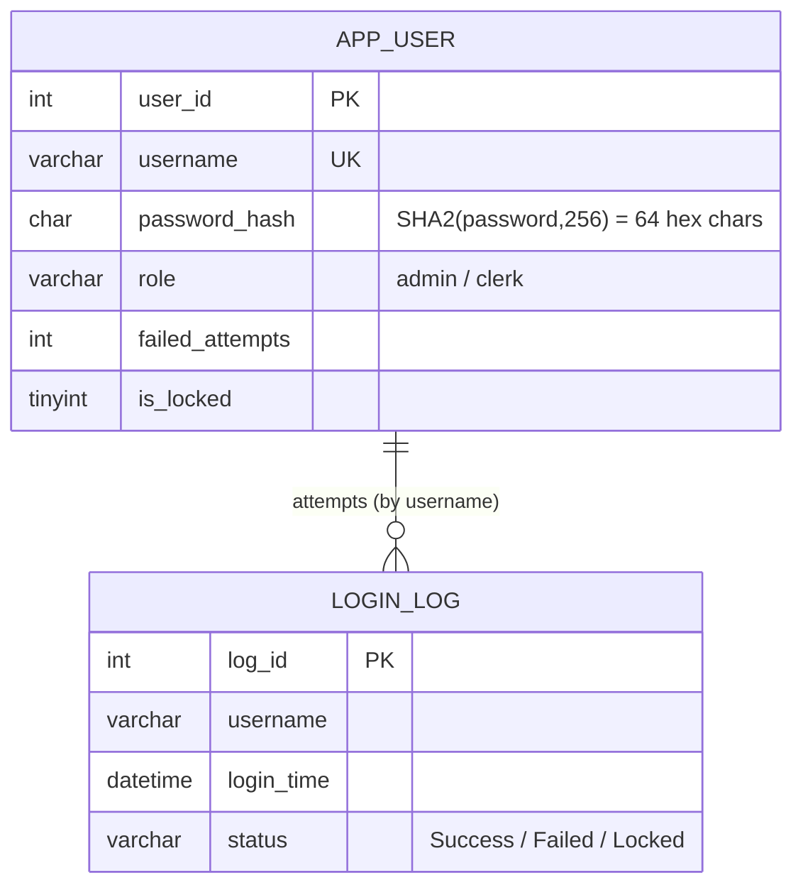

# Explanation - 6D Login Module

## ER / structure diagram

## Concepts used

* Passwords are never stored: the table keeps `SHA2(password, 256)` (64 hex characters). To log in, hash the typed password and compare the hashes.
* **Caveat (important for the viva):** plain unsalted SHA-256 is what the PDF asks for and is fine for the exercise, but real systems use a per-user salt and a slow password hash (bcrypt, scrypt, Argon2) - see ADV 1. Never send a password through SQL logs in production.
* **Account locking**: `failed_attempts` counts consecutive failures, `is_locked = 1` after 3, a success resets the counter, an administrator unlocks.
* **Audit**: every attempt is written to `Login_Log` (Success / Failed / Locked); unknown usernames get the same generic message as wrong passwords so the login form does not reveal which usernames exist.
* **Least privilege**: application code gets `EXECUTE` on procedures only; nobody gets SELECT on `password_hash` (column privileges grant the harmless columns).
* Procedures are `SQL SECURITY DEFINER` (default): they run with the owner's rights, so a clerk can call `login` without any right on App_User.

## Task-by-task logic

### Core tasks (from the PDF)

**Task 1 - Create App_User (username UNIQUE) and Login_Log**  

**Task 2 - Insert the users storing SHA-256 hashes; show the stored hash**  
SHA2('Admin@123', 256) is computed by the server; only the 64-character digest is stored, the plain password is nowhere in the table.

**Task 3 - Procedure register(uname, pwd, role): reject duplicate usernames and passwords shorter than 8 characters**  
Validation order: username present, password length, role, duplicate. The EXIT HANDLER for error 1062 turns a race-condition duplicate (two sessions at once) into the same friendly message.

**Task 4 - Procedure login(IN uname, IN pwd, OUT msg) that compares hashes**  
Version 1: only the comparison. SHA2(typed password) must equal the stored hash. Unknown user and wrong password give the same message.

**Task 5 - On failure increment failed_attempts; set is_locked = 1 after 3 failures**  
Version 2 adds the failure counter and the lock. `is_locked = (n >= 3)` is evaluated in the same UPDATE. A locked account is refused even with the right password.

**Task 6 - Reset failed_attempts to 0 on a successful login**  
Version 3: the success branch also runs `UPDATE ... failed_attempts = 0`. tester2 fails twice (counter 2) and then logs in correctly: the counter returns to 0.

**Task 7 - Log every attempt (Success / Failed / Locked) into Login_Log**  
Final version 4: each branch inserts a Login_Log row; the whole procedure is one transaction (counter update and log row commit together). The test users are removed afterwards so that Task 8 starts from the PDF data.

**Task 8 - One successful login and three failed logins for ravi, then a locked response**  
success -> counter stays 0; wrong x3 -> counters 1, 2, 3 and the lock; the 4th attempt (even with the correct password) is answered with the locked message and logged as 'Locked'.

**Task 9 - Procedure change_password(uname, old_pwd, new_pwd)**  
The old password must match, the new one must be at least 8 characters and different, and a locked account cannot change it. Tested with meena.

**Task 10 - Login history of each user with counts of failed attempts**  

**Task 11 - Procedure unlock_user(uname); GRANT EXECUTE on it only to a DB user with the admin role**  
unlock_user clears the lock and the counter. Roles: admin may EXECUTE every procedure and read the non-secret columns; clerk may only call login and change_password. db_admin holds role admin, db_clerk holds role clerk.

**Task 12 - The clerk DB user cannot execute unlock_user or SELECT password_hash**  
db_clerk may call login (works) but unlock_user gives ERROR 1370; reading the hash column gives ERROR 1143 (column privilege), while the harmless columns are readable.

### Advanced / examiner-style queries

**Adv 1 - Why unsalted SHA-256 is weak - and a salted variant**  
Two users with the same password get the SAME hash (visible to anybody who can read the table and crackable with rainbow tables). A random per-user salt makes equal passwords look different. (Production: bcrypt/Argon2 in the application, not SHA-256.)

**Adv 2 - Users who never logged in successfully**  

**Adv 3 - Locked accounts**  

**Adv 4 - Failed attempts per day**  

**Adv 5 - Duplicate username through direct INSERT**  
Error 1062 (uq_app_user_username) - the UNIQUE constraint backs up register().

**Adv 6 - Invalid role**  
Error 3819 (chk_app_user_role).
