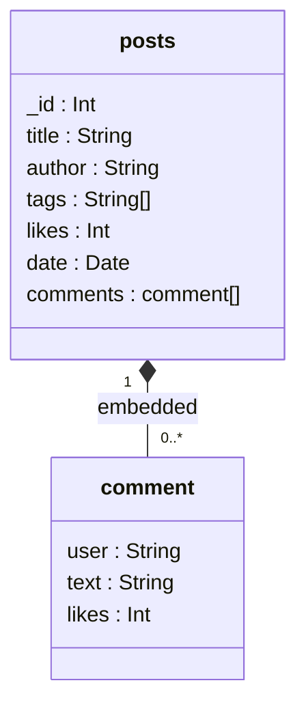

# Explanation - 7A Blog (MongoDB)

## Document structure (collection `posts` in database `blogDB`)

**Design decision - embedding.** Comments are always read together with their post, are bounded in number and have no life of their own, so they are *embedded* in an array. One read returns the whole post; `$push` / `$pull` change comments atomically within one document. If posts could collect thousands of comments (or comments had to be queried independently), a separate `comments` collection referencing `post_id` would be better (*referencing*; see 7B, where orders reference products by id).

## Task-by-task

| Task | Operator(s) | Why |
|---|---|---|
| 1 | `createCollection` + `$jsonSchema`, `insertMany`, `find().pretty()` | validation rejects a post without `author` (error 121) |
| 2 | filter `{author, likes:{$gt}}` + projection `{title:1, likes:1, _id:0}` | implicit AND of conditions; projection returns only the listed fields |
| 3 | `{tags:"mongodb"}` + `sort({date:-1})` | equality on an array field matches if any element equals the value |
| 4 | `$gte` / `$lt` on a Date | half-open range avoids missing the last day |
| 5 | `$elemMatch` | all conditions must hold for the SAME array element; without it separate comments can satisfy separate conditions |
| 6 | `$push`, `$pull` | add an element / remove elements that match a condition |
| 7 | `$inc` | atomic increment, no read-modify-write race |
| 8 | `$addToSet` | adds only if absent: a second run changes nothing (`modifiedCount: 0`) |
| 9 | `$unwind` + `$group` | one document per tag, then count |
| 10 | `$project` with `$size` | array length computed per post; ties are possible, so the pipeline groups by the count and returns all maxima |
| 11 | `$group` + `$sum` + `$sort` | author totals |
| 12 | `deleteMany({comments:{$size:0}, likes:{$lt:15}})` | post 3 survives because Task 6 gave it a comment |

> Execution order used here: `queries.js` -> `crud.js` (Tasks 6-8 and 12) -> `aggregation.js`. In the PDF numbering Task 12 follows the aggregations; running the deletion earlier only removes post 4 from the aggregation results.

## Indexes (`indexes.js`)
Single index `{author:1}`; compound `{author:1, date:-1}` (equality field first, sort field second); text index on `title`; unique index. `explain("executionStats")` compares `COLLSCAN` (`totalDocsExamined` = all documents) with `IXSCAN` (only matching keys/documents). On this tiny collection the difference is 4 vs 2 documents; with millions of documents it is the difference between seconds and milliseconds.
