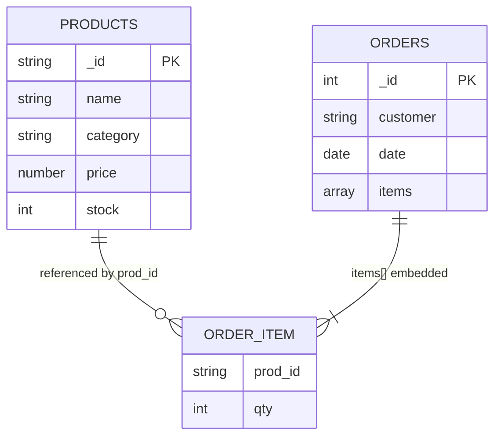

# Explanation - 7B E-commerce (MongoDB)

## Document structure and references (`shopDB`)

* **Embedded**: order lines (`items`) live inside the order (always read/written together).
* **Referenced**: each line stores only `prod_id`; products are shared and change independently, so they stay in `products`. `$lookup` joins at query time (LEFT JOIN).
* Real shops copy the *price at purchase time* into the line on purpose, so history does not change when the catalogue price changes.

## Tasks and results (PDF data)

| Task | Technique | Result |
|---|---|---|
| 2 | `$gte/$lte` | Mouse 500, Desk Lamp 1200 |
| 3 | `$in` = `$or` | Laptop, Mouse, Desk Lamp |
| 4 | `sort({price:-1}).limit(2)` | Laptop, Desk Lamp |
| 5 | `$unwind` -> `$lookup` -> `$unwind` -> `$project` | 4 lines with amounts |
| 6 | `$group` by order | 1001: 56000, 1002: 600, 1003: 1200 |
| 7 | `$group` by category | Electronics 56000, Home 1200, Stationery 600 |
| 8 | group by customer, sort, limit 1 | Sagar 57200 |
| 9 | `$lookup` into orders, keep `$size: 0` | none ordered-never; temp product P5 proves the query |
| 10 | explain before/after `{category:1, price:1}` | COLLSCAN 4 docs -> IXSCAN 2 docs |
| 11 | `updateOne` + `$inc` negative | P1 9, P2 98, P3 490, P4 24 |
| 12 | `deleteMany` by date, `dropIndex` | order 1001 deleted |

> `explain()` figures come from the test shim's simulated planner unless `expected_output.md` says it was produced by a real mongosh.

**Compound index rule (ESR):** Equality fields first, then Sort, then Range.
