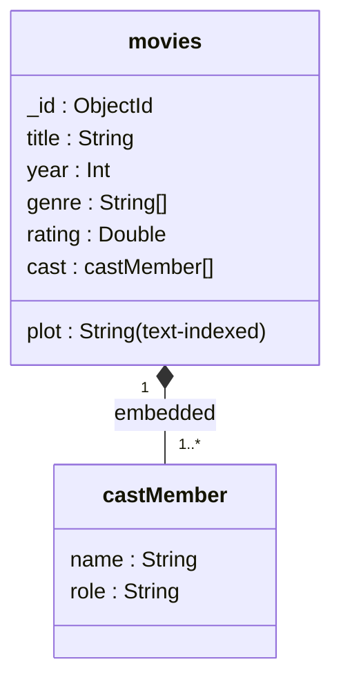

# Explanation - 7C Movie catalogue (MongoDB)

Genres (array of strings) and cast (array of embedded documents) are embedded: a movie is always shown with them. An actor-centric view is produced by `$unwind` + `$group` (Task 6) instead of a separate actors collection.

| Task | Technique | Result |
|---|---|---|
| 2 | `genre: "Sci-Fi"` (array contains) + `year > 2020` | Deep Ocean |
| 3 | `rating` between 7 and 8.5 + projection | Space Journey 8.1, City Lights 7.4 |
| 4 | `"cast.name": "Actor A"` | Space Journey, Deep Ocean |
| 5 | `genre: {$size: 2}` | Space Journey, Deep Ocean |
| 6 | `$unwind cast` + `$group` | Actor A 2, Actor B 2, Actor C 1 |
| 7 | `$unwind genre` + `$avg` | Drama 7.75, Sci-Fi 7.5, Thriller 6.9 |
| 8 | `$sort` + `$group` + `$first` | one movie per year (each year has one movie) |
| 9 | text index on `title`,`plot`; `$text` | City Lights, Deep Ocean |
| 10 | `$addToSet` | Space Journey gets Adventure |
| 11 | pipeline update with `$round` | 8.1 -> 8.3 (plain `$inc` would store 8.299999999999999) |
| 12 | `$pull` + `deleteMany({rating:{$lt:7}})` | Actor B removed from City Lights; Deep Ocean (6.9) deleted |

Text search: words are stemmed and case-insensitive, `-word` excludes, `"phrase"` matches a phrase; one text index per collection (may cover several fields).
