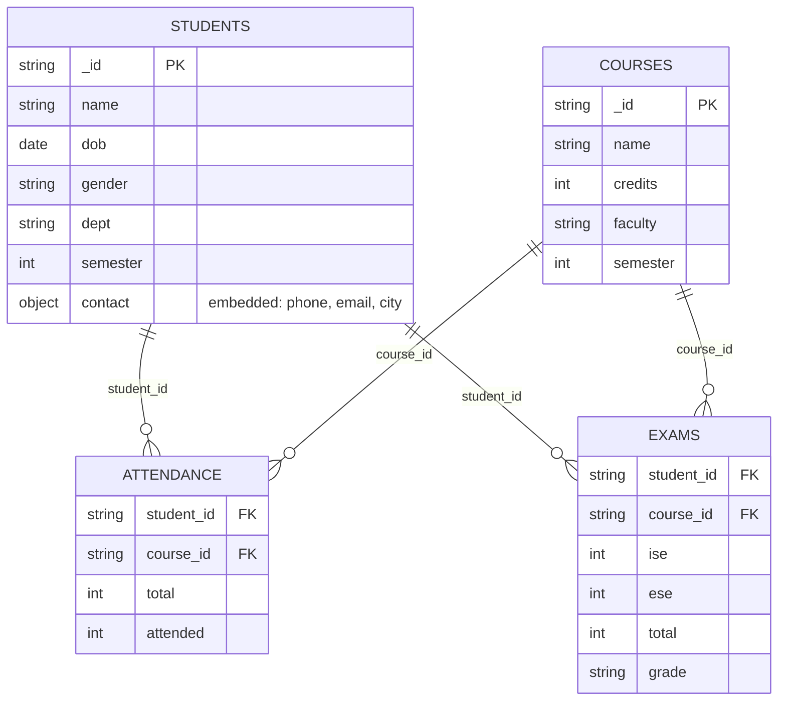

# Explanation - 9A Attendance report (collegeDB)

## Design: embedding vs referencing (justification asked in the PDF)

* **Embedded**: `contact` inside the student (1:1, always read with the student).
* **Referenced**: students and courses are many-to-many; `attendance` and `exams` are the resolving collections with one document per (student, course). Embedding attendance inside the student would make the student document grow with every lecture/course and make "attendance of a course across students" a scan of all students.

## Tasks

| Task | Technique | Result (PDF data) |
|---|---|---|
| 1-2 | collections + `$jsonSchema` on students | semester 9 and a missing name are rejected (error 121) |
| 3 | `{dept:'AIML', semester:3}` | S101, S102, S104 |
| 4 | `"contact.city": "Sangli"` + projection | Aditya, Priya |
| 5 | `$divide`/`$multiply`/`$round` | S101-C1 90, S101-C2 71.05, S102-C1 97.5, S102-C2 92.11, S103-C3 83.33, S104-C1 62.5 |
| 6 | `$match pct < 75` + 2x `$lookup` | Priya (DBMS 62.5), Aditya (DAA 71.05) |
| 7 | `$group` + `$avg` of pct | DBMS 83.33, DAA 81.58, OS 83.33 |
| 8 | `$inc: {total: 2, attended: 2}` | S101-C2 becomes 29/40 = 72.5 % |
| 9 | defaulters joined to students, `$group` by dept | AIML: 2 records, 2 students |
| 10 | `insertOne` student + `insertMany` attendance | S105 (C1 95 %, C2 75 %) |
| 11 | unique compound index `{student_id:1, course_id:1}` | explain: COLLSCAN -> IXSCAN; duplicate pair rejected |
| 12 | `deleteMany({student_id:'S103'})` | 1 document removed |

Run order here: aggregation (5-7, 9) before the updates (8, 10, 12) so the numbers equal those of the PDF data.
