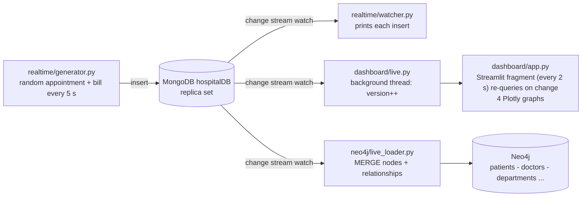

# Experiment 10 - Hospital management with real-time graphs



| Folder | Content | Status |
|---|---|---|
| `database/` | `schema.js` (5 collections + `$jsonSchema`), `insert_data.js`, `queries.js`, `aggregation.js`, `crud.js`, `indexes.js`; Tasks 1-10 | scripts executed with the in-memory test shim - **not yet run on a real MongoDB** |
| `backend/` | `db.py`, `hospital_queries.py` (the 4 dashboard pipelines), `seed.py` | pipelines run with mongomock |
| `realtime/` | `generator.py` (Task 11), `watcher.py` (change stream, Task 11) | generator + dashboard queries verified with mongomock; **change stream needs a replica set and was not run** |
| `dashboard/` | `app.py` (Streamlit + Plotly, 4 graphs), `live.py`, `verify_dashboard.py` | renders and updates its numbers after an insert in a headless test (polling mode); **live change-stream refresh not verified** |
| `neo4j/` | `constraints.cypher`, `load_graph.cypher`, `queries.cypher`, `live_loader.py`, `verify_expected.py` | expected answers cross-checked in Python; **Cypher not executed (no Neo4j available)** |

## Run everything (MongoDB 7 replica set, Python 3.10+)

```bash
pip install -r requirements.txt                    # pymongo, streamlit, plotly, pandas, neo4j
# 1. single-node replica set (change streams need it)
mongod --replSet rs0 --dbpath ./data --port 27017 &     # Windows: mongod --replSet rs0 --dbpath C:\data\rs0
mongosh --eval "rs.initiate()"
export MONGODB_URI="mongodb://localhost:27017/?replicaSet=rs0"      # PowerShell: $env:MONGODB_URI='mongodb://localhost:27017/?replicaSet=rs0'
# 2. schema + data (Tasks 1-10)
cd database && for f in schema.js insert_data.js queries.js aggregation.js crud.js indexes.js; do mongosh "$MONGODB_URI" --quiet --file $f; done && cd ..
# 3. live demo: three terminals
python realtime/generator.py --interval 5          # terminal 1: inserts data
python realtime/watcher.py                          # terminal 2: prints every change-stream event
streamlit run dashboard/app.py                      # terminal 3: http://localhost:8501 - the four graphs move by themselves
# 4. graph (optional): Neo4j 5 (docker run -p7474:7474 -p7687:7687 -e NEO4J_AUTH=neo4j/<password> neo4j:5)
#    paste neo4j/constraints.cypher + load_graph.cypher + queries.cypher into Neo4j Browser, then
python neo4j/live_loader.py --initial               # MongoDB -> Neo4j, then follows the change stream
```

Viva demo (from the PDF): while the dashboard is open insert a new appointment or bill (`generator.py --count 1`, or in mongosh `db.billing.insertOne({...})`): the graphs and the "Latest change events" box update without reloading the page.

**Honest limits:** change streams, the Neo4j Cypher and the real-MongoDB runs could not be executed in the environment where this was written (no MongoDB/Neo4j server). `dashboard/live.py` labels the active mode on the page ("change stream" or "polling fallback") so a polling dashboard is never mistaken for a push dashboard.
