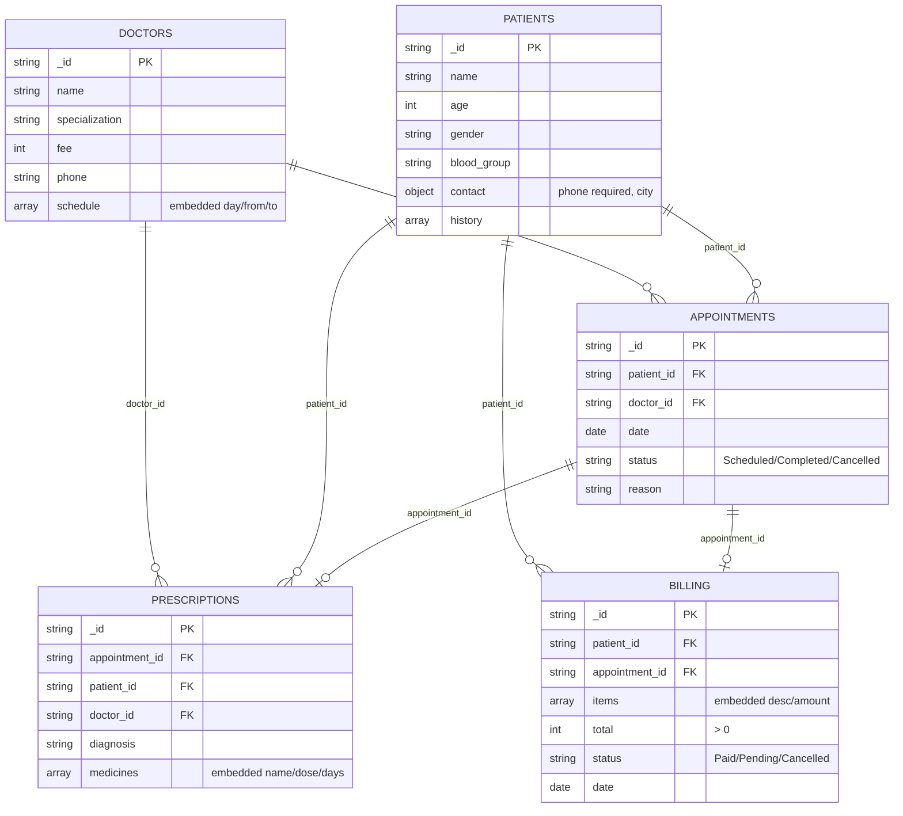

# Explanation - Experiment 10 database (hospitalDB)

## Schema design: one sample document per collection and the references

Embedded (never queried alone, bounded): `contact`, `history`, `schedule`, `medicines`, `items`. Referenced (shared / grow independently): patients, doctors, appointments. A prescription and a bill belong to exactly one appointment.

## Task map

| PDF task | Where | Notes |
|---|---|---|
| 1 five collections with `$jsonSchema` | `schema.js` | patient name + phone required, phone = 10 digits, bill total > 0 (`exclusiveMinimum`), appointment status enum |
| 2 CRUD for every collection; invalid bill | `crud.js`, `insert_data.js` | total -100 -> error 121 DocumentValidationFailure |
| 3 book appointment + bill | `insert_data.js` | bill amount = doctor's fee |
| 4 doctor's appointments today with names | `queries.js` | `$match` day range, 2x `$lookup` |
| 5 patient history in one aggregation | `queries.js` | `$lookup` appointments, prescriptions, billing + `$map`/`$reduce` |
| 6 unpaid bills + total pending | `queries.js` | |
| 7 most prescribed medicines | `aggregation.js` | `$unwind medicines` |
| 8 doctor-wise patients and revenue | `aggregation.js` | distinct patients via `$addToSet`; revenue = paid bills |
| 9 cancel A1003 and its bill | `crud.js` | the sample has no bill for A1003: the script creates BL05 first |
| 10 indexes + explain | `indexes.js` | `{doctor_id, date}`, `{status}`, patient ids, multikey `medicines.name` |
| 11 generator + change stream | `../realtime/` | |
| 12 live dashboard | `../dashboard/` | |

Extra rows A1004, RX02, RX03, BL03 are the ones the Neo4j section of the PDF adds; they are loaded so that MongoDB and the graph hold the same data.
